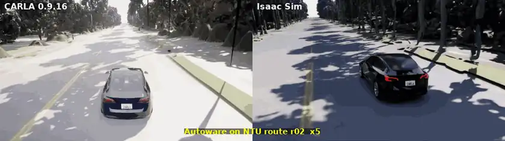
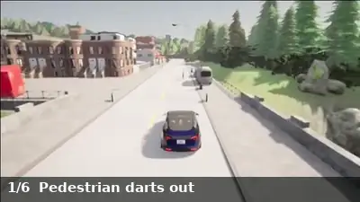
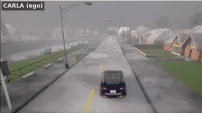
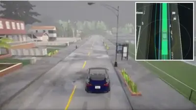
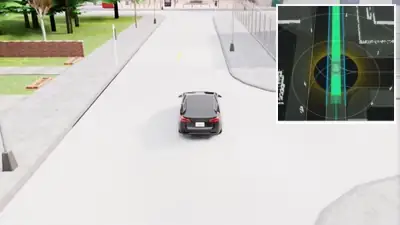
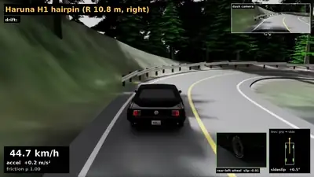
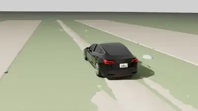

# scenario-world-bridge

Test [Autoware](https://autowarefoundation.github.io/autoware-documentation/main/) on
[OpenSCENARIO](https://www.asam.net/standards/detail/openscenario/) scenarios in
[CARLA](https://carla.org/) or [Isaac Sim](https://developer.nvidia.com/isaac/sim), with
Autoware driving on **simulated sensors**: cameras and lidar feed its full perception,
localization, planning and control, while
[scenario_simulator_v2](https://github.com/tier4/scenario_simulator_v2) (SSv2) runs the
scenario and gives the verdict.

<p align="center">
  <br>
  <em>One Autoware, one vehicle spec, two simulators: the same NTU campus route in CARLA and Isaac Sim (5x).</em>
</p>

<table>
  <tr>
    <td width="33%"><br>
      <b>Six incidents, one drive</b><br><sub>CARLA, Town01: pedestrian, braking car, red light, blocked lane, crossing traffic, cyclist; all pass (3x)</sub></td>
    <td width="33%"><br>
      <b>Two Autoware vehicles</b><br><sub>CARLA, Town01, one scenario (6x)</sub></td>
    <td width="33%"><br>
      <b>AWF adaptive cruise</b><br><sub>CARLA, UC-ACC-001; RViz inset (3x)</sub></td>
  </tr>
  <tr>
    <td><br>
      <b>The same scenarios on Isaac Sim</b><br><sub>Isaac Sim, Town02; RViz inset (2.5x)</sub></td>
    <td><br>
      <b>Hairpin drift on Mount Haruna</b><br><sub>Isaac Sim, sideslip up to 22 degrees</sub></td>
    <td><br>
      <b>Gravel and rocks at 60 km/h</b><br><sub>Isaac Sim, surfaces</sub></td>
  </tr>
</table>

## Why

SSv2 normally runs Autoware against a simulator that hands it the ground truth: perfect
detections and exact positions, so perception is never tested. Here CARLA or Isaac Sim is
SSv2's simulator instead, and Autoware has to *see* the pedestrian, the car ahead and the
traffic light. For someone who already writes SSv2 scenarios:

- **The same `.xosc` files run.** The ego comes from the vehicle catalog, and the map is named
  as `$(env CARLA_MAPS)/Town01`; the [starter scenarios](src/swb_examples/scenarios/) show both.
- **The sensors are the simulator's.** SSv2's sensor requests are declined; Autoware gets the
  simulator's cameras and lidar.
- **The verdict is SSv2's** (a JUnit file), optionally with CARLA's own collision check beside it.
- **Free drive too.** Without a scenario, put the car on the map and drive it from RViz.

## How it works

<p align="center">
  <br>
  <em>A scenario run. The two teal lines are the boundaries every simulator implements.</em>
</p>

- **Scenario side.** SSv2 runs the scenario. The **bridge** turns its requests into one
  simulator-neutral protocol. The **agent relay** passes each Autoware-driven vehicle its
  route and engage.
- **World server**, one per simulator (`swb_carla_world`, `swb_isaac_world`). It loads the map,
  moves the other road users, sets the traffic lights and steps time.
- **Vehicle side.** Your Autoware, connected to the simulator by a **vehicle bridge**
  ([acb](https://github.com/NEWSLabNTU/autoware_carla_bridge) for CARLA,
  [aib](https://github.com/NEWSLabNTU/autoware_isaac_bridge) for Isaac Sim). The vehicle bridge
  publishes the sensors, the vehicle status and the clock, and drives the car from Autoware's
  commands. It runs in its own ROS domain, and can run on another host.

The car is described once, in a vehicle spec. The simulators' physics and sensors, SSv2's
catalog and Autoware's vehicle packages are generated from it, and a run whose parts came
from different specs is refused ([vehicle side](docs/design/vehicle-side.md)).

## Requirements

| | |
|---|---|
| OS, ROS | Ubuntu 22.04, [ROS 2 Humble](https://docs.ros.org/en/humble/Installation.html) |
| Autoware | [1.5.0](https://autowarefoundation.github.io/autoware-documentation/main/installation/): the binary packages in `/opt/autoware/1.5.0`, or your own build of that release |
| Simulator | [CARLA 0.9.16](https://carla.readthedocs.io/en/0.9.16/start_quickstart/) (packaged release) with its Python API (`pip install carla==0.9.16`), or Isaac Sim 6.1 (pip install) |
| Tools | [just](https://github.com/casey/just), [play_launch](https://pypi.org/project/play-launch/) 0.30.0 or newer (`pip install 'play_launch>=0.30.0'`) |
| Hardware | an NVIDIA GPU that runs the simulator beside Autoware. With Isaac Sim, plan for its world server alone holding about 17.5 GB of RAM on Town01 |
| Maps | an Autoware map (Lanelet2 + point cloud) per CARLA town: `just download-maps` fetches them |

SSv2 is bundled (a fork, as a submodule). Isaac Sim also needs the CARLA towns and vehicles
as USD (the asset set). Ask NEWSLab for it.

## Quick start on CARLA

```bash
git clone --recurse-submodules https://github.com/NEWSLabNTU/scenario-world-bridge.git
cd scenario-world-bridge
pip install 'play_launch>=0.30.0' carla==0.9.16
just setup             # Rust, colcon's Rust plugin, rosdep (asks for sudo), dev tools
just build             # colcon build into install/
just download-maps     # the converted CARLA towns, into data/carla-autoware-bridge
source install/setup.bash && ros2 run autoware_sim_profile setup_autoware_data   # once

# CARLA's install, if it is not ~/Downloads/CARLA_0.9.16 (or put the line in .env)
export CARLA_DIR=/path/to/CARLA_0.9.16

just scenario src/swb_examples/scenarios/basic/town01_ego_drive.xosc
cat /tmp/scenario_test_runner/result.junit.xml        # the verdict
```

`just scenario` starts what is not running yet: CARLA, then the stack (the world server, the
bridge, the relay and Autoware). It waits for each, runs the scenario, and leaves them up for
the next one. The first start takes several minutes: CARLA, then Autoware's ~90 processes.
[Getting started on CARLA](docs/getting-started/carla.md) walks through every step, with what
to expect at each.

**On Isaac Sim** the same scenarios run with `sim:=isaac`, once Isaac Sim, its message
bindings (`just isaac-msgs`) and the asset set are installed:
[Getting started on Isaac Sim](docs/getting-started/isaac.md).

## Everyday commands

```bash
just scenario <file.xosc> [sim:=isaac] [output_directory:=<dir>]   # one scenario, its verdict
just run [sim:=isaac] [map_path:=<map>]   # the stack alone, long-lived (play_launch web UI on :8084)
just run spawn:=x,y,z,yaw map_path:=<map> ego_launch_args:=rviz:=true   # free drive: goal, AUTO in RViz
just world-health [sim:=isaac]            # is the world server up and ready?
just carla-start                          # CARLA alone (just scenario starts it itself)
just two-av                               # two Autoware vehicles in one scenario (CARLA up)
just demo-tour                            # six incidents in one five-minute drive (CARLA up)
ros2 run swb_launch run_suite <xosc...> --output <dir> --physical-verdict
    # a suite, against the running stack: scenarios on its town
```

Ctrl-C on `just run`, or stopping its play_launch, ends the whole stack. It runs the installed
binaries, so restart it after `just build`. Host settings, such as
ports, ROS domains, displays and install paths, go in `.env`; the
[User Guide](docs/user-guide.md) lists them. Each part can also run on its own (CARLA,
Autoware, the bridge, as four `ros2 launch` terminals): see
[Tutorial 1](docs/tutorials/01-first-run.md).

**Without a scenario runner.** acb and aib also run Autoware on CARLA or Isaac Sim with no
SSv2 at all: on CARLA you set the scene up with any CARLA client, on Isaac Sim aib's runner
opens the world, and you drive.
`just vehicle-check` in either one checks the car itself (topics, frames, then acceleration,
braking and steering against the spec) with no Autoware.

## Make it yours

| You want to | Start at |
|---|---|
| write your own scenario | [Tutorial 2](docs/tutorials/02-prepare-a-scenario.md), [Writing scenarios](docs/design/scenario-authoring.md) |
| add pedestrians, obstacles, other cars, more Autoware vehicles | [Tutorial 5](docs/tutorials/05-other-road-users.md) |
| run your own Autoware (your launch, your build) | [Tutorial 6](docs/tutorials/06-configure.md), [User Guide: your own Autoware](docs/user-guide.md#your-own-autoware) |
| test your own car: its spec, catalog entry and Autoware launch (`ego_launch:=`, `vehicle_catalogs:=`, `spec_hash_file:=`) | [Tutorial 7](docs/tutorials/07-the-stack.md), [Tutorial 6: another car](docs/tutorials/06-configure.md#another-car) |
| drive with another autopilot than Autoware | [Writing an agent](docs/agent-interface.md) |
| add another simulator | [Tutorial 7](docs/tutorials/07-the-stack.md), [User Guide: another simulator](docs/user-guide.md#another-simulator); a world server passes `swb_world_check conformance` |

## Learn more

- **Getting started**, from install to your own scenario: [CARLA](docs/getting-started/carla.md),
  [Isaac Sim](docs/getting-started/isaac.md).
- **Tutorials:**
  1. [first run](docs/tutorials/01-first-run.md);
  2. [prepare a scenario](docs/tutorials/02-prepare-a-scenario.md);
  3. [run and judge](docs/tutorials/03-run-and-judge.md): suites, verdicts, result files;
  4. [demo run](docs/tutorials/04-demo-run.md): two Autoware vehicles, screencasts;
  5. [other road users](docs/tutorials/05-other-road-users.md);
  6. [configure](docs/tutorials/06-configure.md);
  7. [the whole stack in one launch](docs/tutorials/07-the-stack.md).
- **Reference:**
  - the [User Guide](docs/user-guide.md): install, maps, running, weather, troubleshooting;
  - [all documentation](docs/README.md).
- **Developers:**
  - the [Developer Guide](docs/development.md): building with `just`, tests, the
    repositories this one pins as submodules, how a request flows;
  - the [design documents](docs/design/);
  - the [roadmap](docs/roadmap/README.md).

**Other CARLA versions.** CARLA 0.9.16 is tested. 0.9.14 and 0.9.15 build
(`CARLA_VERSION=0.9.15 just build`, with that release's CARLA, maps and `carla` wheel) but
are untested; the bridges refuse a server of another
version than they were built for. 0.10 is not supported yet.

## Related projects

- [scenario_simulator_v2](https://github.com/tier4/scenario_simulator_v2): Autoware's
  scenario testing framework.
- [AWSIM](https://github.com/tier4/AWSIM): a Unity-based SSv2 simulator.
- [carla-rust](https://github.com/jerry73204/carla-rust): Rust bindings for CARLA's C++ API.
- [play_launch](https://pypi.org/project/play-launch/): `ros2 launch` with per-node logs and a
  web UI.

## License

[Apache 2.0](LICENSE).
