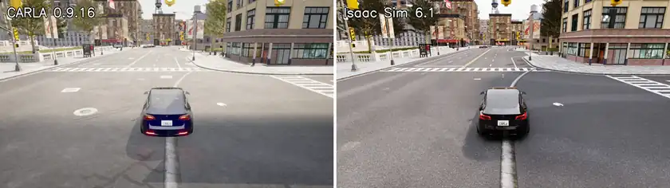
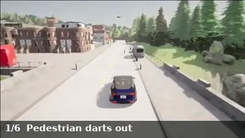
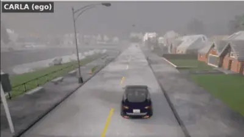
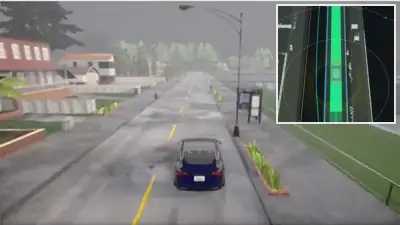
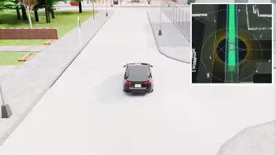
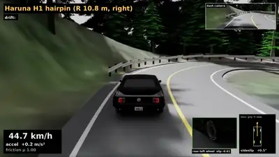
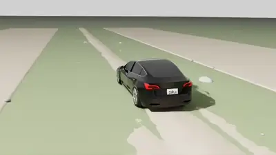
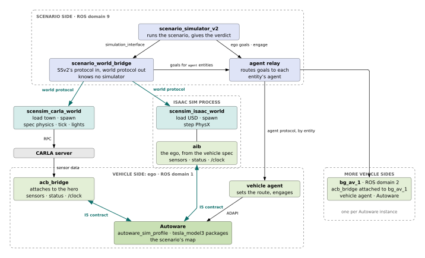

# scenario-world-bridge

scenario-world-bridge (swb) evaluates an autopilot on
[OpenSCENARIO](https://www.asam.net/standards/detail/openscenario/) scenarios in
[CARLA](https://carla.org/) or [Isaac Sim](https://developer.nvidia.com/isaac/sim). The
autopilot drives on **simulated sensors**: the simulator's cameras and lidar feed its own
perception, localization, planning and control, while
[scenario_simulator_v2](https://github.com/tier4/scenario_simulator_v2) (SSv2) executes the
scenario and returns the verdict. [Autoware](https://autowarefoundation.github.io/autoware-documentation/main/)
is the autopilot most of the examples use; it is one choice among several.

<p align="center">
  <br>
  <em>One Autoware, one vehicle spec, two simulators: the same Town10HD route in CARLA and Isaac Sim (3x).</em>
</p>

<!-- Each image row and its caption row sit in their own <tbody>: GitHub stripes every
     second row of a tbody, so both are a first row and share one colour. -->
<table>
  <tbody><tr>
    <td width="33%" valign="bottom"></td>
    <td width="33%" valign="bottom"></td>
    <td width="33%" valign="bottom"></td>
  </tr></tbody>
  <tbody><tr>
    <td valign="top"><b>Six incidents, one drive</b><br><sub>CARLA, Town01: pedestrian, braking car, red light, blocked lane, crossing traffic, cyclist; all pass (3x)</sub></td>
    <td valign="top"><b>Two Autoware vehicles</b><br><sub>CARLA, Town01, one scenario (6x)</sub></td>
    <td valign="top"><b>AWF adaptive cruise</b><br><sub>CARLA, UC-ACC-001; RViz inset (3x)</sub></td>
  </tr></tbody>
  <tbody><tr>
    <td width="33%" valign="bottom"></td>
    <td width="33%" valign="bottom"></td>
    <td width="33%" valign="bottom"></td>
  </tr></tbody>
  <tbody><tr>
    <td valign="top"><b>The same scenarios on Isaac Sim</b><br><sub>Isaac Sim, Town02; RViz inset (2.5x)</sub></td>
    <td valign="top"><b>Hairpin drift on Mount Haruna</b><br><sub>Isaac Sim, sideslip up to 22 degrees</sub></td>
    <td valign="top"><b>Gravel and rocks at 60 km/h</b><br><sub>Isaac Sim, surfaces</sub></td>
  </tr></tbody>
</table>

## Why

SSv2 normally runs Autoware against a simulator that hands it the ground truth: perfect
detections and exact positions, so perception is never tested. Here CARLA or Isaac Sim is
SSv2's simulator instead, and Autoware has to *see* the pedestrian, the car ahead and the
traffic light. For someone who already writes SSv2 scenarios:

- **The same `.xosc` files run**, on either simulator. A scenario names its map through a
  variable the stack sets to the project's map directory (`$(env SWB_MAPS)/Town01`) and
  its cars from the vehicle catalog, never by a path of the local machine.
- **The sensors are the simulator's.** SSv2's sensor requests are declined; Autoware gets
  the simulator's cameras and lidar.
- **The verdict is SSv2's**, with CARLA's own contact check and user-defined judges beside
  it.
- **Any autopilot.** Autoware, CARLA's BasicAgent, a launch file or a Python program may
  drive any vehicle of a scenario, several of them at once. An autopilot that is not
  Autoware drives its car through Autoware's vehicle interface (its control and status
  messages).

## How it works

<p align="center">
  <br>
  <em>A scenario run. The two teal lines are the boundaries every simulator implements.</em>
</p>

Work is organised in **projects**: a project is a directory with a `swb.yaml` that names the simulator, the
assets (maps, USD worlds, cars) and which **pilot** drives each scenario entity. A
long-lived **stack** brings up the simulator side and the pilots; each **run** of a
scenario goes against it and leaves a result. These words and the others the pages use
are in the [glossary](docs/reference/glossary.md);
[How it works](docs/explanation/how-it-works.md) says more.

In outline, after [installation](docs/getting-started/install.md), with CARLA installed
and its directory recorded in the host settings file (`~/.config/swb/host.yaml`, see
Install), so that the stack starts it:

```bash
ros2 run swb project new ~/my_first_drive        # a starter project
cd ~/my_first_drive
ros2 run swb assets fetch                        # its map, from Hugging Face
play_launch launch --web-addr 127.0.0.1:8080 \
    swb_launch swb.launch.xml                    # the stack: it remains running
ros2 run swb run scenarios/drive_to_goal.xosc    # in a second terminal
```

The run ends with one line, `passed   <run id>  <run directory>`, and exits 0.
[Tutorial 1](docs/tutorials/01-first-drive.md) goes through it step by step.

## Requirements

The fixed requirements are the platform and the build tools:

| Component | Requirement |
|---|---|
| OS, ROS | Ubuntu 22.04, [ROS 2 Humble](https://docs.ros.org/en/humble/Installation.html) |
| Autoware's messages | Autoware's interface messages (`autoware_adapi_v1_msgs` and the vehicle and control messages), from an Autoware workspace or its binary packages (required to build, whichever autopilot drives) |
| Launcher | [play_launch](https://pypi.org/project/play-launch/) 0.30.0 or newer |
| Build tools | Rust ([rustup](https://rustup.rs/)) and colcon's Rust plugin, `colcon-cargo-ros2` |

The simulator and the autopilot are choices, each with the versions it has been tested
with:

| Component | Options and tested versions |
|---|---|
| Simulator | [CARLA 0.9.16](https://carla.readthedocs.io/en/0.9.16/start_quickstart/) (the packaged release; the version is fixed at build time, see [Supported and not supported](docs/reference/limits.md#platform)), or Isaac Sim 6.1 (pip install) |
| Autopilot | [Autoware](https://autowarefoundation.github.io/autoware-documentation/main/installation/) (tested with 1.5.0, binary packages or a build; swb provides the car's launch files and configuration), CARLA's BasicAgent, a simple pilot on the ground truth, or a launch file or program of one's own |
| Hardware | an NVIDIA GPU that runs the simulator beside the autopilot. Isaac Sim: an RTX GPU with 24 GB and 64 GB of RAM |

SSv2 is bundled (a fork, as a submodule).

## Start here

| You are | Read |
|---|---|
| **New to swb** | [Install](docs/getting-started/install.md), [Getting started on CARLA](docs/getting-started/carla.md), then the [tutorials](docs/README.md#tutorials) in order |
| **Adopting swb** for your project: your car, your autopilot, your maps | [Start a project of your own](docs/how-to/start-a-project.md), the [how-to guides](docs/README.md#how-to-guides) and the [reference](docs/README.md#reference) |
| **Teaching** a course or a lab | [Teaching with swb](docs/teaching.md): seats on one host, the tutorials as labs, grading with judges |
| **Writing scenarios** | [Tutorial 2: write a scenario](docs/tutorials/02-write-a-scenario.md), [What a scenario may use](docs/reference/scenarios.md) |
| **Integrating an autopilot** | [Your autopilot as a pilot](docs/how-to/your-autopilot.md), [the agent SDK](docs/reference/agent-sdk.md) |
| **Developing swb itself** | the [Developer Guide](docs/development.md) |

[All documentation](docs/README.md). What swb does not do, on one page:
[Supported and not supported](docs/reference/limits.md).

## Datasets

Public, on Hugging Face. A project names them in `swb.yaml`, and `ros2 run swb assets
fetch` downloads only what it takes:

| Dataset | Holds | Licence |
|---|---|---|
| [carla-town-autoware-maps](https://huggingface.co/datasets/jerry73204/carla-town-autoware-maps) | CARLA's towns as repaired Autoware maps (lanelet2, point cloud), Town01's Isaac world | LGPL-3.0 |
| [carla-0.9.16-isaac-usd](https://huggingface.co/datasets/jerry73204/carla-0.9.16-isaac-usd) | CARLA 0.9.16's towns, vehicles, props and walkers as USD for Isaac Sim | CC BY 4.0 |
| [haruna-tsukuba-courses](https://huggingface.co/datasets/jerry73204/haruna-tsukuba-courses) | the Mount Haruna mountain road and Tsukuba Circuit: Isaac worlds and Autoware maps | ODbL, GSI |
| [isaac-road-physics-stages](https://huggingface.co/datasets/jerry73204/isaac-road-physics-stages) | Isaac test stages for road surfaces, a proving ground, a rough road | Apache-2.0 |
| [newslab-golfcart-models](https://huggingface.co/datasets/jerry73204/newslab-golfcart-models) | a golf cart for Isaac Sim and RViz | Apache-2.0 |

## Related projects

- [scenario_simulator_v2](https://github.com/tier4/scenario_simulator_v2): Autoware's
  scenario testing framework.
- [AWSIM](https://github.com/tier4/AWSIM): a Unity-based SSv2 simulator.
- [carla-rust](https://github.com/jerry73204/carla-rust): Rust bindings for CARLA's C++ API.
- [play_launch](https://pypi.org/project/play-launch/): `ros2 launch` with per-node logs and a
  web UI.

## License

[Apache 2.0](LICENSE).
