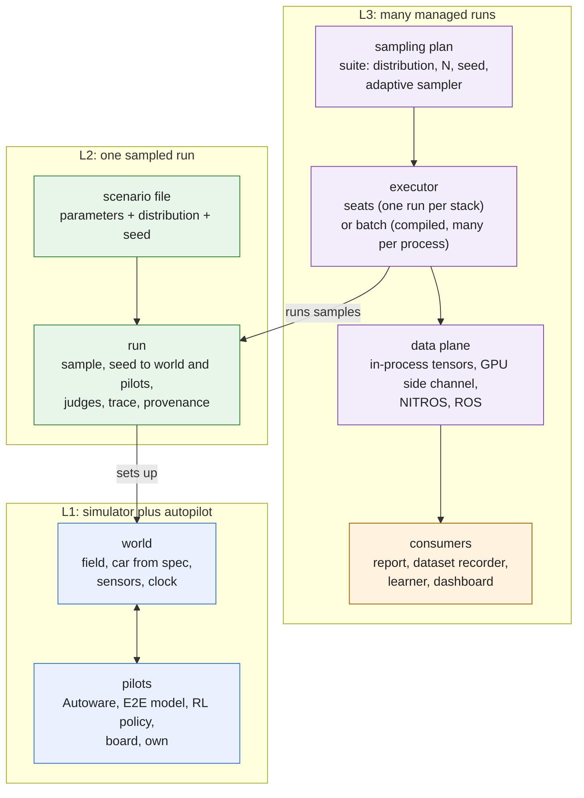
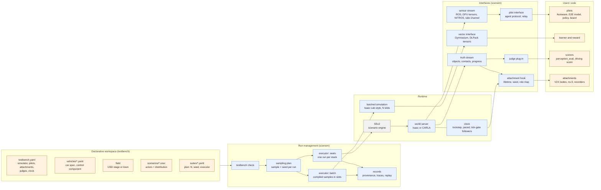
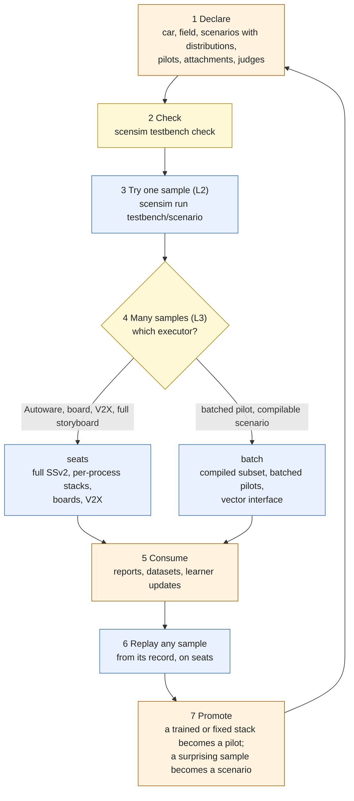

# Building blocks for learned policies: run, sample, batch, evaluate (draft)

Status: draft for review, revision 3, 2026-11-20. Not a roadmap phase yet.

Source: a RoboRacer team (TUM) gave feedback after a scensim presentation on 2026-11-20. They
train and deploy RL and ML policies and know simulation well. Their pain points:

- training seeds many simulation runs, and each world is set up by hand;
- data crawls between the autopilot, the simulator and the training infrastructure;
- they need ROS 2 Jazzy as well as Humble.

Revision 2 follows the user's review of the first draft:

- no special-purpose `training:` section: randomness lives in the scenario file and in the
  autopilot;
- the design is organised as layers of application;
- batching uses compiled scenarios (option b);
- evaluation is covered as well as training: real target platforms, several actors on
  different ML stacks, vision under varied scenes, V2X;
- scensim provides building blocks that users combine; it does not cover every use case.

Revision 3 narrows the scope (user): scensim owns the interfaces, the efficient management of
runs, the efficiency of data and computation, and the declarative workspace. Users adapt to the
interfaces and build their own ML training and evaluation patterns on them; scensim does not
abstract those patterns.

## 1. Decisions

| # | Decision | From |
|---|---|---|
| D1 | scensim's scope is four things: interfaces, efficient run management, efficient data and computation, and the declarative workspace. Training and evaluation patterns (learners, rewards, scorers, model runtimes, board integration, datasets, V2X stacks) are the users', built on the interfaces; scensim ships examples of them, not abstractions | user |
| D2 | Adopt existing technology where it fits: Isaac Lab's batched simulation, NITROS, NCCL, TensorRT, perception_eval, CARLA 1.0's V2X sensors | user |
| D3 | No patches to official ROS; Humble and Jazzy | user |
| D4 | No training-specific specification. A scenario file carries its own sampling (OpenSCENARIO `ParameterValueDistribution`, which SSv2 already interprets); the autopilot carries its own randomness, seeded per run | user |
| D5 | Three layers: L1 simulator plus autopilot; L2 one sampled run of a scenario; L3 many managed runs | user |
| D6 | L3's batched executor compiles scenarios into a batched simulation built on Isaac Lab (adopted, not reimplemented). Scenarios outside the compilable subset, and components without a batched form, run one per seat, as today | user (option b) |
| D7 | One interface across simulators: Isaac Sim and CARLA 1.0 (and 0.9.16) behind the same blocks, each at its own throughput | user |
| D8 | Deployment and evaluation on the real target: the user compiles the model; scensim runs it through the pilot interface, on the host or on a board | user |
| D9 | Gradients stay in the learner; NCCL between GPUs is the user's. The reward is the learner's: scensim streams observations and events, not rewards | finding, and D1 |
| D10 | V2X is optional and attaches as a block; nothing requires it | user (2026-11-15 rule) |

## 1a. Scope: what scensim owns, what users build

| scensim owns | Users build on it |
|---|---|
| **Interfaces**: the world protocol, the pilot interface (agent protocol, relay), the sensor and truth streams, the clock (lockstep, paced), the judge interface, the attachment hook, the batched vector interface | learners and rewards; model runtimes (TensorRT, ONNX Runtime, a board's own); perception and driving scorers (perception_eval, a driving score); V2X stacks and network simulators; dashboards |
| **Run management**: sampling plans and seeds end to end, executors (seats, batch), retries, provenance, replay of any sample | which samples to run next (an adaptive sampler is a user plug-in on the plan) |
| **Efficiency**: batched simulation, GPU-resident data in process, GPU transport between processes (NITROS, a CUDA IPC side channel), seat isolation and placement | the user's own multi-GPU training (NCCL) |
| **Declarative workspace**: the testbench, the car spec, the field (USD stage or town), scenario files with their distributions, suites | the contents: their cars, fields, scenarios, pilots |

The test for a new feature: if a user could build it on the interfaces without changing
scensim, it is an example, not a block. Section 6 describes such patterns; they ship as
examples (`scensim_examples`) to copy and adapt.

## 2. The layers



**L1, simulator plus autopilot.** A field, a car and one or more pilots, with no scenario.
The world steps under a clock (lockstep, or paced to wall time for a board), publishes
sensors and accepts commands. This is what `just run` does today, and a policy developer
uses it as a single environment.

**L2, one sampled run.**

- A scenario file states the setup, the actors, their pilots and the sampling: parameter
  ranges and distributions, and the number of runs (SSv2's `Stochastic` with `numberOfTestRuns`
  and `randomSeed`, or `Deterministic` sets and ranges).
- One run is one sample: a concrete parameter set plus a run seed. The run seed reaches the
  scenario sample, the simulator's own randomness (traffic, sensor noise, weather variation),
  and each pilot (as `{seed}` in its arguments, or as an SSv2 controller property).
- The run writes `result.json`, judge verdicts, a trace and its provenance, which names the
  sample. Replaying a sample reproduces the run.

**L3, many runs.**

- *The sampling plan* is a suite: which scenarios and distributions, how many runs, a base seed,
  and optionally a sampler that picks the next sample from earlier results (as in the gap
  campaign).
- *The executor* places runs. `seats` runs each sample on its own stack, as today, with full
  scenario semantics. `batch` compiles samples into one batched simulation (section 5).
- *The data plane* moves sensor data and events to the consumers.
- *The consumers* are the user's: a report, a dataset recorder, a learner. Training is L3 with
  a learner as consumer and a learning policy as pilot; it needs no section of its own.

Rollouts: when a run inside a batch ends, the executor draws the next sample from the same
plan and resets that slot. The scenario file needs no new syntax for it.

## 2a. Architecture



Key: amber is the user's, blue is scensim's, grey is third-party used as is. The users' code
touches scensim only through the interfaces in the middle column.

## 2b. Workflow



## 3. The blocks

Each block has one job and a stable interface. Users compose them in a testbench.

| Block | What it does | Exists today | New |
|---|---|---|---|
| **World** | a simulator behind the world protocol; field, weather, lights, time | world servers (CARLA, Isaac), `set_weather` | scene parameters settable from a scenario sample (section 6.3) |
| **Car** | the car from one spec, per simulator body | spec v2, bodies, rigs | rig from spec on Isaac (091 W5) |
| **Pilot** | the interface anything that drives an entity uses: Autoware, a launch file, a program, an exported model, a board | pilots of six kinds, agent protocol, relay | in-process access to the batched streams for a batched pilot; a model pilot and a board pilot ship as examples, not blocks (section 6.1) |
| **Sensor stream** | sensors from the car's spec to a pilot | vehicle bridges publish ROS topics | GPU tensors in process; a GPU side channel or NITROS between processes; a compressed stream to a board |
| **Truth stream** | ground truth per step: objects with boxes and occlusion, lanes, signals, contacts, route progress | parts, in judges and traces | one published stream, per step, which any block can read |
| **Clock** | how time advances | lockstep in simulated time | paced mode for boards (simulated time held to wall time, with the lag recorded) |
| **Scenario** | setup, actors, sampling | SSv2, distributions, suites | the compilable subset for `batch` |
| **Judge** | the interface for a verdict or metric from a run | judges, `result.json` | a judge plug-in point; scorers such as perception_eval or a driving score are users' plug-ins, with one example |
| **Attachment** | any extra process tied to a run's lifetime, clock and seed: a recorder, an evaluator, a V2X stack, a network simulator | the tick gate's followers, the episode files, the gap trace | a declared attachment with the entity-to-role map and start and stop per run (section 6.4) |
| **Executor** | places runs | seats, suites, retries | `batch` (section 5) |
| **Record** | provenance and traces | runs layout, provenance, logs | the sample and seed per run or slot; dataset writers are users' consumers of the streams |

## 4. Real evaluation pipelines, and the blocks they use

The examples were read for the blocks they need. The gaps they expose are work items.

| Pipeline | What it is | Blocks | Gap |
|---|---|---|---|
| **Bench2Drive** ([NeurIPS 2024](https://arxiv.org/abs/2406.03877)) | closed-loop evaluation of end-to-end models on CARLA: 44 interactive scenarios across locations and weathers, 220 routes, a driving score and success rate per ability | scenario sampling over town and weather, model pilot, judge | a driving-score judge adapter; weather and location as sample parameters |
| **CARLA Leaderboard and Roach** ([ICCV 2021](https://arxiv.org/abs/2108.08265)) | route-based evaluation of a sensor agent; an RL expert trained on a bird's-eye view, then imitated | pilot, truth stream (BEV), record (data for imitation) | BEV rendered from the truth stream |
| **driving_log_replayer v2** ([docs](https://tier4.github.io/driving_log_replayer_v2/overview)) | Autoware's evaluator: perception scored against annotations by perception_eval, or without annotations from online metrics; planning and control from evaluator metric topics | judge adapter, truth stream as the annotation | perception scoring against simulated truth: perception_eval reading our truth stream |
| **OpenCDA** ([arXiv 2107.06260](https://arxiv.org/abs/2107.06260)) | cooperative driving on CARLA with SUMO traffic: V2X, cooperative perception, platooning; collects V2X perception data (OPV2V) | attachment (V2X), truth stream, record | V2X stacks and their network simulators attach; non-commercial licence, so a reference, not a dependency |
| **Board in the loop** (e.g. [MMRHP](https://arxiv.org/html/2510.18371v1); our NXP board with SSv2) | the stack on the target board; sensors injected; latency measured; Autoware's tracking broke past about 40 ms of injected latency in that study | board pilot, paced clock, sensor stream to the board | the paced clock; a latency record per command; sensor compression |
| **Wheeled Lab** ([CoRL 2025](https://arxiv.org/abs/2502.07380)) and **RoboRacer Arena** ([arXiv 2608.23040](https://arxiv.org/pdf/2608.23040)) | small cars trained on Isaac Lab or Isaac Sim with heavy randomisation; residual RL over Pure Pursuit; deployed zero-shot | batch executor, scenario sampling, model pilot | residual actions over a named base controller; observation history recorded with the model |
| **GPUDrive** ([ICLR 2025](https://arxiv.org/html/2408.01584v3)) | multi-agent driving on recorded scenes, about a million steps per second | batch executor | several learning actors per environment (later) |

## 5. The batch executor (option b)

The executor compiles a scenario sample into a slot of a batched simulation: N clones of the
field in one Isaac process, stepped together on the GPU (Isaac Lab's model).

- **The subset that compiles.** Start poses, routes, speeds, NPC routes with constant or
  profiled speed, simple distance and time triggers, weather and scene parameters (section
  6.3), and the end conditions. A scenario outside the subset is refused for `batch` by name,
  with the first construct that does not compile, and runs on `seats` instead.
- **Pilots in a batch.** A batched pilot steps all slots at once: an RL policy or an exported
  model on the GPU. Autoware and other per-process stacks do not batch; they run on `seats`.
- **The interface for learners.** A batched run is also a Gymnasium vector environment:
  observations as tensors (DLPack across PyTorch, JAX, Warp), actions in, per-step events out
  (contacts, route progress, judge states, episode ends). The learner computes its reward
  from them (D9).
- **Same car, same component.** The rig comes from the car's spec, and the 091 control
  component runs inside the physics step, in batched form.
- **Provenance per slot.** Each slot records its sample and seed, so any slot's episode can be
  replayed as an L2 run on `seats`, with full SSv2 semantics. That is how a surprising training
  episode becomes a test.

## 5a. Throughput

Training throughput is environment steps per second across all slots. The batch executor is
built on Isaac Lab (D2), not a simulator of our own. Its ceiling is therefore Isaac Lab's, and
scensim's job is to add as little as possible on top: compiling the scenario, the car and the
field, sampling, and records.

### Reference numbers

These are published figures, each on its own hardware and release. They are not comparable
with each other, only with themselves.

| System | Workload | Throughput | Source |
|---|---|---|---|
| Isaac Lab 2.2, RTX 4090 | Cartpole, state only, 4096 envs | about 1.1 M steps/s | [performance benchmarks](https://docs.nvidia.com/isaaclab/2.2/overview/performance-benchmarks) |
| Isaac Lab 2.2, RTX 4090 | Cartpole, RGB camera, 1024 envs | about 50 k steps/s | same |
| Isaac Lab 2.2, RTX 4090 | Unitree G1 locomotion, rough terrain, 4096 envs | about 94 k steps/s | same |
| Isaac Lab 3.0 | Cartpole state, 4096 envs, against camera, 1024 envs | 857 k against 31.6 k steps/s (mean) | [run benchmarks](https://isaac-sim.github.io/IsaacLab/v3.0.0/source/developer-tools/benchmarking/run_benchmarks.html) |
| Wheeled Lab, one RTX 3080 | small-car drifting, Isaac Lab | a transferable policy in a couple of hours | [README](https://github.com/Hashu-CH/WheeledLab), [paper](https://arxiv.org/abs/2502.07380) |
| Xcar drift, RTX 3080 | 1/10 car, custom PyTorch simulator, state only, about 10^5 envs | PPO converges in about 11 min | [arXiv 2507.23339](https://arxiv.org/abs/2507.23339) |
| GPUDrive, consumer GPU | multi-agent driving, kinematic, 512 worlds | about 1 M agent steps/s; 20 to 30 M training steps per hour | [ICLR 2025](https://arxiv.org/html/2408.01584v3) |
| scensim today, seats on Isaac | one car, full sensors, SSv2 in lockstep, loaded host | about 10 steps/s per stack (tick median 94 ms) | our run, 2026-11-20 (`isaac_verge`) |

These figures give three lessons:

- **Seats are no training path.** They are three to five orders of magnitude below a batch. A
  seat is worth its cost for evaluation only.
- **Cameras cost about 20 to 30 times state alone** at equal scale, on Isaac Lab's own
  Cartpole. Sensors are the first throughput decision.
- **A RoboRacer car with a planar lidar and state** sits between Cartpole and locomotion in
  cost. It has to be measured on our field, not assumed.

### Where a step's time goes, and what the batch executor does about it

| Cost | Risk | Rule in the batch executor |
|---|---|---|
| The control component | 091's component steps one car in Python; with 2048 slots, that is 2048 calls per physics step | A batch requires a **batched component**: `step_batch(commands, sensors, dt)` on tensors (Torch or Warp), one call for all slots. A component without it is refused for `batch` by name and still runs on seats |
| Cameras | rendering dominates once any camera is on | tiled rendering; only the sensors the pilot declares, at their declared resolution and rate; sensor periods decoupled from physics (Isaac Lab's update period) |
| Lidar | ray casts per slot | batched GPU ray casting (Warp), with the spec's beam count |
| Physics | substeps times slots | the policy rate decimated from physics; substeps from the car's measured needs (091), not a global default |
| Resets | a scene reset stalls every slot | per-slot reset in tensors (pose, velocity, randomised parameters); no stage reload; samples drawn on the GPU from the compiled distribution |
| Host synchronisation | Python per slot, or `.item()`, stalls the GPU | events and truth in batch mode are tensors; nothing per slot in Python |
| Scenario logic | triggers evaluated per slot in Python | the compilable subset compiles to vectorised conditions over all slots (distance, time, speed, region) |
| Field size | a large stage times slots exhausts VRAM | the field is instanced: shared meshes, per-slot transforms; slots per GPU sized from measured VRAM |
| Policy inference | the learner's own | the user's (mixed precision, CUDA graphs); the step is capturable, with no Python control flow per slot |
| Several GPUs | one process cannot span them | one batch process per GPU, sharing one sampling plan with disjoint seeds; the learner's NCCL joins them |

### Our design against Isaac Lab

| | Isaac Lab, an environment written by hand | scensim's batch executor | scensim's seats |
|---|---|---|---|
| The environment | Python configuration classes (scene, observations, events, rewards, terminations) | compiled from the declarative workspace: car spec, stage, scenario with its distribution | the same workspace, run in full |
| Randomisation | the event manager | the scenario's distribution, plus the pilot's own seed | the same distribution, one sample per run |
| Reward | reward terms in the environment | the user's, from per-step events (D9) | not applicable |
| Throughput | the ceiling | the ceiling, less the compile and record overhead (target below) | about 10 steps/s per stack |
| Scenario semantics | none built in | the compilable subset | full SSv2 |
| Other simulators | Isaac only | Isaac only (Isaac Lab) | Isaac, CARLA 1.0, CARLA 0.9.16 |
| Evaluation and deployment | the user's own | replay any slot's sample on seats | suites, judges, pilots, boards, V2X |
| Car and field | written per task | one spec, one stage, shared with evaluation | the same |

What scensim adds over a hand-written Isaac Lab environment is not speed: it is that the same
declared car, field and scenario train in a batch and are then evaluated, replayed and deployed
on seats without being rewritten. What it must not do is cost speed.

### Benchmark and target

- **The benchmark.** `scensim bench <suite>` reports steps per second against slot count (256,
  1024, 4096) for three sensor sets: state only, the planar lidar, and one camera per car. It
  splits each step by stage (physics, sensors, component, scenario conditions, resets,
  transfer) per GPU, and records the hardware, the driver and the Isaac Lab release.
- **The baseline.** A hand-written Isaac Lab environment with the same car, field and sensors,
  built as part of B6.
- **The working target.** The batch executor stays within 20 % of that baseline at every slot
  count. The figure is to be confirmed after the first measurement. Absolute targets come from
  the first RoboRacer measurement, not before.

A batched V2X network is outside this design: attachments run on seats. GPU-batched network
simulation exists as research ([arXiv 2610.02370](https://arxiv.org/html/2610.02370v1)) and
could become an attachment form later.

## 6. Evaluation patterns users build (examples, not blocks)

### 6.1 The real target platform

A board pilot (an example on the pilot interface) runs the stack on the target (a Jetson, an NXP board) and talks to the run over
the network, through the agent protocol's relay, which already crosses domains.

- **Clock.** A board runs in wall time. The paced clock holds simulated time to wall time and
  records the lag. A run whose lag exceeds its budget is marked as such, not silently
  stretched.
- **Sensors.** Sensors are encoded for the link (compressed images, decimated lidar) at rates
  the board declares.
- **Latency.** Every command is stamped, so latency per command, from sensor to actuation, is
  part of the record.

### 6.2 Several actors on different ML stacks

A scenario names a pilot per entity: Autoware for one car, an end-to-end vision model for
another, an RL policy for a third, a board for a fourth.

- **Seats.** Seats isolate each pilot's ROS domain, as today (`multi_av`).
- **Sensors.** Each pilot gets the sensors of its own car's spec.
- **Judges.** Judges score each actor separately, and the run records which pilot drove which
  entity.
- **Transport.** Where pilots on one host consume the same camera data, they share it on the
  GPU (NITROS or the side channel) rather than each taking a copy.

### 6.3 Vision under varied scenes

Scene parameters become scenario parameters, so a distribution sweeps them. They cover
weather, sun angle and time of day, wet roads, fog, lighting presets, props and surfaces, and,
on Isaac, variants of the authored stage.

- **How they reach the world.** The world server applies them at the start of a run (the
  weather path exists).
- **Two kinds of scoring.**
  - *Closed-loop:* the run's judges.
  - *Perception:* the pilot's detections against the truth stream, through perception_eval, the
    scorer Autoware's own evaluator uses.

### 6.4 V2X, as an attachment

An attachment is a process declared in the testbench and tied to a run. It receives the run's
seed, the entity-to-role map, and start and stop at the run's edges. It follows the run's clock
as a follower of the world server's tick gate (`SCENSIM_TICK_GATE`, which already takes
several followers). It reads the truth stream and writes into the run's record. Nothing in a
run requires V2X, and a scenario with V2X also runs without it.

A neighbouring lab project gives the requirements. It runs shared perception and junction
space leases over a simulated 5G network, which ns-3 5G-LENA and a ray tracer model.

- **What it exchanges.** Each car runs a node that reads its own stack's state (pose, tracked
  objects) and UWB ranges, and sends its own packets every 100 ms (state, tracks, leases), with
  evidence patches every 200 ms. The packets travel over Zenoh through the network simulator.
  A roadside node grants leases from the junction's lights.
- **What it needs from the simulator.** Every vehicle's true pose each frame, by role name, to
  drive the network simulator's mobility and line of sight. True ranges for the UWB model.
  Truth logged per run for scoring. The cars' own state still comes from each stack, never
  from truth.
- **Clock.** Simulated time in lockstep, with the network simulator, the junction coordinator
  and the ray tracer as tick-gate followers. Zenoh's keep-alives and TCP still run on wall
  time, so the record states it.
- **Lifetime.** The nodes start fresh per run and stop after the verdict. The network
  simulator and gateways live for a lab (one town). Seeds go to the network simulator and the
  UWB noise.
- **What it asks of scensim**, in its order:
  1. the attachment hook (entity-to-role map, start and stop per run);
  2. the tick gate with several followers, kept as it is;
  3. per-run recorded truth (poses, actor ids, frame times) in the run directory.

  It needs no channel model from us. CARLA 1.0's V2X sensor would serve only as a quick
  baseline.

So the attachment hook (B4) and the truth stream (B3) cover V2X. A channel model is not a
scensim block.

## 6a. Usage by user

Each example shows what the user writes and what they run. Keys marked *proposed* are new in
this design; the rest exist today.

### An RL researcher (a RoboRacer team): train in a batch, evaluate on seats

```xml
<!-- scenarios/lap.xosc: the start and the surface are sampled -->
<ParameterDeclarations>
  <ParameterDeclaration name="start_s" parameterType="double" value="0"/>
  <ParameterDeclaration name="floor_mu" parameterType="double" value="0.8"/>
</ParameterDeclarations>
<!-- scenarios/lap_dist.xosc -->
<ParameterValueDistribution>
  <ScenarioFile filepath="lap.xosc"/>
  <Stochastic numberOfTestRuns="100000" randomSeed="7">
    <StochasticDistribution parameterName="start_s">
      <UniformDistribution><Range lowerLimit="0" upperLimit="42"/></UniformDistribution>
    </StochasticDistribution>
    <StochasticDistribution parameterName="floor_mu">
      <NormalDistribution expectedValue="0.8" variance="0.004">
        <Range lowerLimit="0.6" upperLimit="1.0"/>
      </NormalDistribution>
    </StochasticDistribution>
  </Stochastic>
</ParameterValueDistribution>
```

```yaml
# suites/train.yaml
distribution: scenarios/lap_dist.xosc
executor: {kind: batch, slots: 2048, device: cuda:0}   # proposed
```

```python
# their training script: scensim gives the vector interface, they own the rest
import scensim.batch                                    # proposed
env = scensim.batch.open("suites/train.yaml")           # gymnasium.vector.VectorEnv
obs, info = env.reset()
for it in range(iterations):
    act = policy(obs["scan"], obs["state"])             # torch tensors on cuda:0
    obs, _, term, trunc, info = env.step(act)
    reward = my_reward(info["events"])                  # progress, contacts: theirs to weigh
    learner.update(obs, act, reward, term | trunc)
```

Evaluation runs the exported policy as an ordinary pilot on seats, against the full
scenarios:

```yaml
# testbench.yaml (excerpt)
pilots:
  ego: {kind: command, vehicle: my_racer,
        run: [python3, -m, my_team.onnx_pilot, --model, models/race.onnx]}
```

```bash
scensim run my_twin/suites/eval.yaml
```

### A perception engineer: one vision stack, swept over weather

```yaml
# suites/weather.yaml
distribution: scenarios/crossing_weather.xosc  # sun altitude, rain, fog, wet road as parameters
seed: 100
judges: [my_eval.perception:score]             # their judge: perception_eval against truth
```

```yaml
# testbench.yaml (excerpt)
pilots:
  ego: {kind: launch, launch: my_vision_stack stack.launch.xml, inputs: [sensors]}
```

Each run's record holds the sample (the weather), the truth stream and the judge's scores, so
a table of recall against fog density is a query over the results.

### An integrator: several stacks in one scenario

```yaml
# testbench.yaml (excerpt)
pilots:
  ego:     {kind: autoware, vehicle: tesla_model3}
  bg_av_1: {kind: launch, launch: my_e2e vad.launch.xml}    # an end-to-end vision model
  bg_av_2: {kind: command, run: [python3, -m, my_rl.pilot]}  # an RL policy
```

Each pilot gets its own seat (ROS domain), its own car's sensors and its own judges. The run
records which pilot drove which entity.

### A platform engineer: the stack on the target board

```yaml
# testbench.yaml (excerpt)
pilots:
  ego: {kind: none, vehicle: my_racer}  # the board connects to the relay itself
clock: {mode: paced, max_lag_s: 0.05}   # proposed: simulated time held to wall time
```

On the board, their stack talks to the relay over the network with the agent protocol. Each
run records the clock's lag and a latency per command, so the board's timing is part of the
verdict.

### A V2X researcher: their network and nodes, attached

```yaml
# testbench.yaml (excerpt)
attachments:                                 # proposed
  ns3:  {run: [netlab/start_ns3.sh], lifetime: lab, follows_clock: true}
  node: {run: [seps_node, --role, "{role}", --seed, "{seed}"],
         per: entity, lifetime: run}         # one per entity, from the role map
```

Their nodes read each car's own stack and their network simulator reads the truth stream; the
run directory gets the per-run truth they score against. Without `attachments:`, the same
scenarios run with no V2X.

### A test engineer: suites and replay

```bash
scensim run my_project/suites/c3.yaml           # the plan's samples on seats
scensim run --replay runs/2026-11-20T19-05-02   # proposed: the same sample, same seed
```

A failing sample from a training batch replays the same way, on seats, with full SSv2.

## 7. Transport

| Data | Between | Mechanism |
|---|---|---|
| observations, actions, events in a batch | within one process | tensors; nothing to transport |
| gradients and parameters | the user's learners | NCCL |
| camera frames to a pilot process on the same host | process to process | NITROS where the stack uses Isaac ROS (3.2 on Humble, 4.x on Jazzy); a CUDA IPC side channel otherwise; ROS topics as the fallback |
| sensors to a board | host to board | compressed stream over the relay |
| commands, states, scenario control | everywhere | ROS topics and the world protocol |

Notes:

- **NITROS.** It is zero-copy only within one process. Between processes it uses the NITROS
  Bridge. Isaac ROS 4.5 dropped the GXF implementation, so the 4.x API has to be pinned.
- **ROS Lyrical.** Lyrical's `rosidl::Buffer` with its CUDA backend does the same job
  upstream. It is not in Humble or Jazzy, and D3 rules out backporting it. When a distro has
  it, our side channel steps aside.

## 8. Not in scope

- learners, RL algorithms and experiment tracking;
- model export and compilation;
- scorers, model runtimes, board drivers and dataset writers as maintained blocks (they are examples);
- differentiable simulation;
- patching ROS;
- a V2X stack or a channel model of our own.

## 9. Open questions

1. **Isaac Lab and our stage.** Which Isaac Lab release fits Isaac Sim 6.x, and can it clone an
   authored stage with our session layer (091 W13)?
2. **The compilable subset.** Start poses and NPC routes first; which triggers next?
3. **The batched control component.** A vectorised `step` over slots: a second method, or a
   second component?
4. **The paced clock's budget.** How much lag may a board run carry before its verdict is void?
5. **The truth stream's form.** Is it a ROS topic set, the world protocol, or both? It must be
   cheap enough to publish every step.
6. **Attachments that outlive a run.** A network simulator lives for a lab (one town), its
   nodes for a run: does an attachment declare its lifetime (run, lab), as pilots do?

## 10. Work items (sketch, for a roadmap phase once approved)

| Item | What | Layer | Depends on |
|---|---|---|---|
| B1 | Seeds end to end: run seed to sample, world and pilots; provenance names the sample; replay a sample | L2 | none |
| B2 | Scene parameters as scenario parameters (weather, light, surfaces, stage variants) | L2 | B1 |
| B3 | The truth stream | L1 | none |
| B4 | The judge and attachment plug-in points: declaration, lifetime, clock, seed, entity-to-role map, record | L2 | B1 |
| B5 | The paced clock, with the lag and a latency stamp per command recorded | L1 | none |
| B6 | The batch executor on Isaac Lab: compiled subset, slots, rollouts, the vector interface, the batched component, replay on seats; exit: `scensim bench` against a hand-written Isaac Lab baseline (section 5a) | L3 | B1, 091 W5 |
| B7 | GPU transport between processes: NITROS profile, CUDA IPC side channel | L3 | none |
| B8 | Jazzy for the whole set (with 082 step 7) | all | 082 |
| B9 | Examples, each a pattern to copy: a RoboRacer policy trained in a batch and evaluated on seats; an exported model as a pilot; a board pilot; a vision stack swept over weather and scored with perception_eval; two stacks in one scenario; V2X attached | all | the above |
