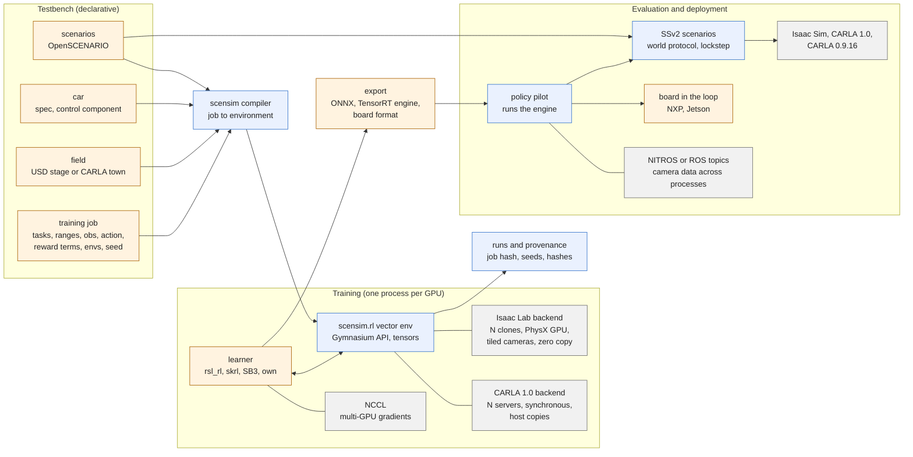
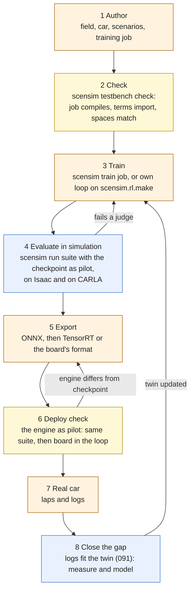

# Training and deploying learned policies: the design (draft)

Status: draft for review, 2026-11-20. Not a roadmap phase yet.

Source: feedback from a RoboRacer team (TUM) after a scensim presentation, 2026-11-20. They
train and deploy RL and ML policies and know simulation well. Their pain points:

- **Many runs, set up by hand.** Training seeds many simulation runs, and each world is still
  set up by hand.
- **Slow data movement.** Data crawls between the autopilot, the simulator and the training
  infrastructure, above all camera frames.
- **Jazzy.** They need ROS 2 Jazzy as well as Humble.

## 1. Decisions

| # | Decision | From |
|---|---|---|
| D1 | scensim provides interfaces and functions that different ML users build on; it does not cover the whole ML workflow (no learner, no experiment tracker, no model compiler) | user |
| D2 | Adopt existing technology where it fits (Isaac Lab's vectorised environments, NITROS, NCCL, TensorRT) rather than invent | user |
| D3 | No patches to official ROS; Humble and Jazzy both supported | user |
| D4 | Training follows Isaac Lab's model: many environments stepped as a batch in one process, observations as GPU tensors. scensim compiles a declarative training job into such an environment (option A) | user (A chosen over a batched world server) |
| D5 | One interface across platforms: CARLA 1.0 is a training backend behind the same interface, at its own throughput | user |
| D6 | Training does not need the multi-simulator setup (world server, SSv2, lockstep) that evaluation uses; throughput comes first | user |
| D7 | Deployment: the user compiles the model (ONNX, TensorRT engine, or a board's own format); scensim runs it through the autopilot (pilot) interface, in scenarios and on boards, as with the NXP board and SSv2 | user |
| D8 | Gradients stay in the learner. Model-free RL (PPO, SAC) needs only observations, rewards and resets from the simulator; gradients between GPUs are NCCL's, inside the user's learner. Differentiable physics is out of scope | finding (section 6) |
| D9 | The Python interface is Gymnasium's vector environment, with tensors as observations | ours |
| D10 | Rewards and terminations: a small built-in library of terms, plus user terms registered as Python entry points (as 091's control components are) | ours |
| D11 | During training SSv2 does not run; a scenario family is compiled into initial conditions, randomisation and a supported subset of behaviours. SSv2 runs the evaluation | ours |
| D12 | Every training run records its job hash, per-environment seeds and provenance (stage, spec and component hashes), in the run layout scensim already has | ours |

## 2. Architecture



Key: amber is the user's, blue is scensim's, grey is third-party used as is.

The same testbench feeds both halves. Training reads the job and compiles it into a vector
environment; evaluation runs the same scenarios in SSv2, with the exported policy as a
pilot. The car comes from one spec in both (the `bodies:` mechanism of roadmap 083), and so
does the control component (091), so a policy trained on one backend can be evaluated on the
other. The difference between the two is a measurement in its own right.

## 3. Workflow



Steps 4 and 6 use the scensim that exists today (suites, judges, `result.json`, pilots);
steps 1 to 3 and the policy pilot are new.

## 4. The training job

A new `training:` section in a testbench, or a file it names. An example for a RoboRacer
racing task:

```yaml
# training/race.yaml
backend: isaaclab            # or carla
envs: 2048                   # carla: servers x cars per server
seed: 7                      # environment i draws from seed + i
episode_s: 30
step_hz: 50                  # policy rate; physics substeps follow the field
field: fields/lab_hall       # a USD stage (091), or a CARLA town
car: vehicles/my_racer.yaml  # spec v2, with its control component
tasks:                       # where an episode starts and what it is for
  - scenario: scenarios/lap.xosc      # start pose, route; compiled, not run
    weight: 0.8
  - scenario: scenarios/overtake.xosc # NPCs on the supported subset
    weight: 0.2
randomise:                   # ranges, sampled per environment per reset
  floor_friction: [0.6, 1.0]
  mass_scale: [0.95, 1.05]
  motor_gain: [0.9, 1.1]
  latency_s: [0.00, 0.03]
observations:
  scan: {sensor: lidar, history: 2}
  state: [speed, yaw_rate, steering]
  path: {waypoints: 60, spacing_m: 0.2}
action:
  interface: ackermann        # ackermann | vesc | autoware_control
  residual_over: pure_pursuit # optional: the policy adds to a base controller
rewards:
  progress: 1.0
  collision: -10.0
  scensim_terms.my_team:smooth_steering: -0.1   # a user term (entry point)
terminations: [collision, off_track, timeout]
```

What the compiler does with it:

- **field.** On Isaac Lab, the stage is cloned `envs` times on a grid; surfaces and colliders
  come from the stage as 091 designs (the stage is the source of truth). On CARLA, the town is
  loaded on each server.
- **car.** The rig is generated from the spec (aib's generator, 091 W5); the control
  component runs inside the physics step, batched over environments.
- **tasks.** Each scenario is read for its start, route and goal, and for the NPCs' initial
  states and the supported subset of actions (section 7). Its storyboard is not executed.
- **randomise.** Each entry becomes a reset event, and the sample per environment is stored
  in the run.
- **observations.** The car's sensors are named from its spec. Cameras use tiled rendering on
  Isaac Lab and are delivered as GPU tensors.
- **action.** It is mapped onto the same command interface that the car's stack uses
  (091 W18), so the trained policy speaks the deployed stack's language.

## 5. The Python interface

```python
import scensim.rl as rl

env = rl.make("training/race.yaml", device="cuda:0")  # gymnasium.vector.VectorEnv
obs, info = env.reset(seed=7)          # obs: dict of torch tensors, leading dim = envs
for _ in range(steps):
    act = policy(obs)                   # torch tensor on the same device
    obs, rew, term, trunc, info = env.step(act)

env.run.record(checkpoint="ckpt/iter_500.pt")   # provenance for the checkpoint
```

- **Learners.** rsl_rl, skrl and Stable-Baselines3 attach through their usual wrappers.
- **Capabilities.** `env.capabilities` reports where tensors live, whether physics is
  deterministic per seed, the maximum environments per process, and the backend.
- **Tensor exchange.** Tensors cross library boundaries through DLPack (PyTorch, JAX, Warp,
  CuPy).
- **Commands.** `scensim train <job> --learner rsl_rl` is a thin launcher over the same
  interface, for users who want no code of their own. It is optional (D1).

## 6. What crosses process boundaries, and with what

| Data | Where it moves | Mechanism |
|---|---|---|
| observations, actions, rewards during training | within one process | Isaac Lab tensors; nothing to transport |
| gradients and parameters between GPUs | learner to learner | NCCL (the user's learner, e.g. torch.distributed) |
| camera frames to a separate inference process in evaluation | process to process, same host | NITROS where the stack uses Isaac ROS (3.2 on Humble, 4.x on Jazzy); otherwise ROS topics |
| any GPU buffer between our own processes | process to process | CUDA IPC or VMM handles over a small side channel, if NITROS does not fit; descriptors only on ROS |
| commands, states, scenario control | everywhere | ROS topics and the world protocol, as today |

Notes:

- **NITROS.** It is zero-copy only between nodes in one process. Between processes it uses
  the NITROS Bridge. Isaac ROS 4.5 dropped the GXF implementation, so the 4.x API has to be
  pinned.
- **ROS Lyrical.** Lyrical's `rosidl::Buffer` with its CUDA backend does the same job
  upstream, with no side channel. It is not in Humble or Jazzy, and D3 rules out
  backporting it. When a distro has it, our side channel steps aside.
- **The common case.** In the RL workflow, the volume moves inside the training process.
  Cross-process GPU transport matters for evaluation and deployment, where a separate
  inference process or a board consumes camera frames.

## 7. Real examples, mapped onto the design

Each example was read for what it would need from scensim. The gaps it exposes are work
items.

| Example | What it does | How it maps | Gap it shows |
|---|---|---|---|
| **Wheeled Lab** ([CoRL 2025](https://arxiv.org/abs/2502.07380), [code](https://github.com/UWRobotLearning/WheeledLab)) | Isaac Lab for small cars (HOUND, MuSHR; F1TENTH listed as coming): drifting, elevation traversal, visual navigation, zero-shot to real; heavy randomisation and massive parallelism; RSL-RL and SB3 | `backend: isaaclab`, `randomise:`, camera observations; the closest match to D4 | Observation history must match between training and playback; the job records it, and the policy pilot reads it from the job |
| **RoboRacer Arena** ([arXiv 2608.23040](https://arxiv.org/pdf/2608.23040), 2026) | Isaac Sim, GPU PhysX (TGS), 130 tracks generated from specifications (also from text), 270° lidar by GPU ray casting, residual RL over Pure Pursuit, ROS 2 bridge with Ackermann commands; 1080 lidar values, 11 state values and 60 waypoint features per frame | `field:` from generated stages; `action: residual_over: pure_pursuit`; the observation example above | Generated fields: a track generator feeding stages is a later item (with 091's map twin); residual actions over a named base controller |
| **Learning to drift with individual wheel drive** ([arXiv 2507.23339](https://arxiv.org/abs/2507.23339)) | A 1/10 car with four motors on VESC; a custom GPU simulator in PyTorch with a Pacejka tyre; PPO with about 10^5 environments, converging in about 11 min; randomised tyre B, C, D; reported path error 0.14 m in simulation and 0.22 m on the real car (from a summary of the paper's tail, to verify) | `randomise:` over tyre parameters; the reported gap motivates 091's measured tyres | Per-wheel drive: the action interface needs a per-wheel profile beyond ackermann and vesc |
| **F1TENTH Gym with SB3** ([f1tenth_gym](https://github.com/f1tenth/f1tenth_gym), [RLPP](https://arxiv.org/html/2501.17311v2)) | Kinematic simulator; PPO tunes Pure Pursuit's lookahead, or adds a residual; deployed through ROS 2 on the 1/10 car | A cheap backend that fits the same interface; PPO over a base controller | A kinematic backend (f1tenth_gym) could sit behind `scensim.rl` for the first iterations; optional |
| **Roach** ([ICCV 2021](https://arxiv.org/abs/2108.08265), [code](https://github.com/zhejz/carla-roach)) | CARLA 0.9.10.1, PPO on a bird's-eye-view image, 10M steps; the RL expert then teaches an imitation agent | `backend: carla`; the BEV is an observation the compiler renders from ground truth | BEV observations from ground truth; data collection for imitation from evaluation runs (record mode) |
| **GPUDrive** ([ICLR 2025](https://arxiv.org/html/2408.01584v3)) | Multi-agent driving on recorded scenes, about one million steps per second on one GPU, tens of millions of training steps per hour | The throughput ceiling for kinematic multi-agent work; scenario-driven like our tasks | Multi-agent self-play (several learning cars per environment) is not in the first version |

What the examples agree on:

- Model-free on-policy RL (PPO), many parallel environments and heavy randomisation (D4, D8).
- Small cars benefit from residual control over a classical controller, which also eases
  deployment.
- The policy's observation and action must be defined once and shared by training and
  deployment. That is the job file's purpose (D7, D11).

## 8. Backends

| | Isaac Lab | CARLA 1.0 |
|---|---|---|
| environments | clones in one process (thousands for state, hundreds with cameras) | one car per server, or several cars per world; servers on separate ports |
| tensors | GPU, zero copy | host memory, copied to the device |
| physics | PhysX GPU; the car from the spec; the control component batched | Chaos; the car from the spec's `carla-1.0` body |
| determinism | per seed on one GPU, within PhysX limits | synchronous mode, fixed delta, `deterministic_collisions` |
| sensors | tiled cameras, ray-cast lidar | CARLA sensors, fisheye, solid-state lidar |
| when to use | training | cross-simulator check, CARLA-specific sensors and towns |

A backend is a plug-in under one entry-point group (`scensim.rl_backends`), so a team can add
its own (a kinematic simulator, a JAX simulator) without changing scensim.

## 9. Not in scope

- RL algorithms, learners and experiment tracking. The user's choice: rsl_rl, skrl, SB3,
  Weights & Biases, their own.
- Model export and compilation (ONNX, TensorRT, a board's compiler). The policy pilot runs
  the result.
- Differentiable simulation.
- Running SSv2 inside the training loop.
- Patching ROS.

## 10. Open questions

1. **Which Isaac Lab release.** Our Isaac Sim is 6.x; which Isaac Lab release supports it, and
   does its scene cloning accept an authored stage with our session layer (091)?
2. **The behaviour subset.** How much of a scenario's storyboard should training honour:
   start poses only, or also NPC routes and simple triggers? The first version does start
   poses and NPC routes.
3. **Batching the control component.** The 091 component steps one car. A batched form (a
   vectorised `step` over environments) is needed for throughput; is it a second method or a
   second component?
4. **Policy pilot runtimes.** TensorRT on x86 and Jetson, ONNX Runtime on CPU; the NXP board's
   runtime is the board's own. Which ones ship with scensim, and which are the user's?
5. **CARLA 1.0 at scale.** How many servers fit on one GPU with the RoboRacer-size sensor
   set? To be measured once 083 runs on 1.0.

## 11. Work items (sketch, for a roadmap phase once approved)

| Item | What | Depends on |
|---|---|---|
| T1 | The job schema and `testbench check` for it | none |
| T2 | `scensim.rl.make`, the vector interface, capabilities, run provenance | T1 |
| T3 | The Isaac Lab backend: stage cloning, rig from spec, batched component, randomisation events, lidar and tiled cameras | T2, 091 W5 |
| T4 | The term library and the entry-point group for user terms | T2 |
| T5 | The policy pilot: run an exported engine in a suite (TensorRT, ONNX Runtime) | none |
| T6 | The CARLA 1.0 backend | T2, 083 |
| T7 | Residual actions over a named base controller | T3 |
| T8 | Cross-process GPU transport for evaluation: NITROS profile, CUDA IPC side channel otherwise | T5 |
| T9 | Jazzy for the whole set (with 082 step 7) | 082 |
| T10 | The worked example: a RoboRacer racing job trained on Isaac Lab, evaluated on Isaac and CARLA, deployed as a pilot | T3 to T6 |
