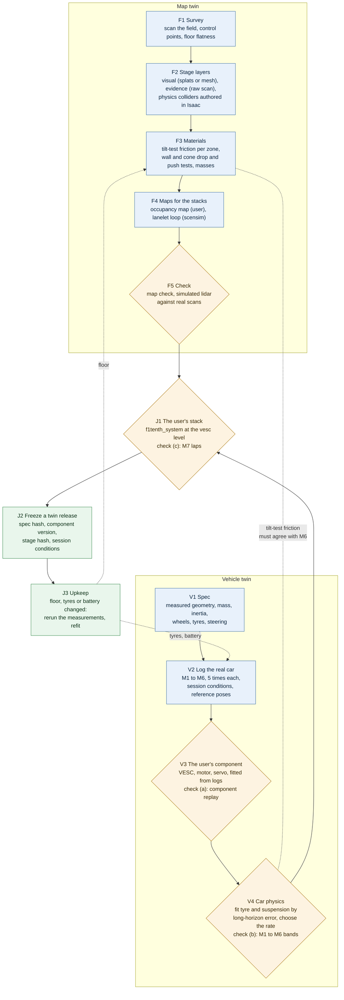

# A RoboRacer indoor twin: the design (roadmap 091 step 1)

This note fixes four interfaces before any code is written (091 step 2 onward):

- the plug-in point for the user's control component;
- the authored USD stage as the source of truth;
- the vehicle interface for an `ackermann_msgs` stack;
- the measurement protocol and its acceptance bands.

Read against `sim_vehicle_ecu` b4dda7d (`signals`, `calibration`, `powertrain.make`, `ecu`) and
aib b05142f (`rig`, `gen`, `isaac/vehicle.py`, `isaac/ego.py`, `runner`). Status: approved by 133 on 2026-11-20, with its four notes folded in.

## 1. Where the component sits today

aib builds the ego from a rig: a `VehicleParams` for the PhysX vehicle and a
`sim_vehicle_ecu.Calibration` from the spec. The PhysX vehicle runs with "drive none": it has
no engine model of its own. On every physics step of the world, `Ego.before_substep(dt)` calls
`Vehicle.apply(cmd, dt, state)`, which does three things:

1. builds `Request(acceleration, velocity, tire_angle, gear)` from the vehicle interface's last
   command;
2. calls `Ecu.step(request, sensors, dt)`, where `sensors` are the car's own readings after
   the last step: four wheel speeds, the yaw rate and two accelerations, or `None` before the
   first step;
3. writes each wheel's drive torque, brake torque and steer angle into PhysX. The bicycle tire
   angle is split into Ackermann angles by `aib.control`, and `release_sticky` is applied
   (issue 070).

`Ecu` is steering, then the estimator, then ESC, then the powertrain. `powertrain.make` picks
`ideal` or `ev` by name, and `fmu` and `physx` raise `NotImplementedError`. A "substep" here is
one world physics step: `dt = 1 / (frame_rate x substeps)`, 1/60 s at the defaults. Inside it,
PhysX's vehicle runs its own `physx_substeps` with the torques held. `teleport` calls
`ecu.reset()`.

On a RoboRacer, the user's control component is the whole of `Ecu`, not only its powertrain:
- the VESC (speed control, motor, its own current and brake limits);
- the servo, which is the steering actuator.

So **the plug-in point is `Ecu`'s place**. Step 2 makes `Ecu` itself the first implementation
of the interface, with `ideal` and `ev` inside it, as the roadmap asks.

## 2. The control component

### 2.1 The interface

A component is a Python class. It must be pure, which means it uses no ROS, no simulator
import, no I/O in `step`, no threads, no wall clock, and no unseeded randomness. It may use the
standard library and `numpy`, which Isaac Sim's Python provides. It is imported by the world
server's interpreter: Isaac's Python 3.12, not the system's 3.10.

This is a real constraint on a user's model, and it is stated as such:
- **A compiled model** (C, C++, Simulink, Modelica, a vendor's binary) goes through the `fmu`
  component (2.5): exported as an FMI 2.0 co-simulation unit, it is stepped by a shipped
  component.
- **A model that needs ROS** (a node, a topic, a service) goes through neither. It cannot be
  stepped inside the physics loop, and a ROS node acting a step late is what 091 rules out.
  Such a model has to be reduced to its input-output behaviour first: the measurements of 5
  and a component fitted to them.

```python
class MyCar:
    commands = "ackermann"           # or "vesc", or "autoware": what it takes (2.3)

    def __init__(self, vehicle: dict, params: dict, seed: int):
        """vehicle: the spec's document as the simulator's body sees it (geometry, inertia,
        wheels, tires, steering; spec v2). params: the testbench's `params:` for it. seed:
        the run's seed, for any modelled noise."""

    def reset(self):
        """A new episode: a spawn, a teleport, a scenario start. Every state at rest."""

    def step(self, command, sensors, dt) -> Actuation:
        """One physics step of dt s. command: the last command received, or None before the
        first one (2.3). sensors: the car's own readings after the last step, or None on the
        first step after a reset (2.4)."""
```

`Actuation` is `sim_vehicle_ecu.signals.Actuation`, with one optional field added:

| field | unit | meaning |
|---|---|---|
| `drive` | N m, 4-tuple | drive torque per wheel, signed along the car's x; FL, FR, RL, RR |
| `brake` | N m, 4-tuple | brake torque per wheel, a magnitude (it opposes the wheel's spin) |
| `tire_angle` | rad, + left | the bicycle tire angle after the steering actuator; aib splits it by the spec's linkage (`steering.ackermann`) |
| `telemetry` | dict, optional | what the real controller reports (for a VESC: `erpm`, `duty`, `current_motor`, `current_input`, `voltage_input`, `tachometer`), in its own units, for the vehicle interface to publish (4.2) and the run to record |

The rules for `step`:

- **Units.** SI throughout: m, s, rad, N m, m/s. Wheel order FL, FR, RL, RR, as
  `sim_vehicle_ecu.signals`. A car with one motor and a differential returns the torque at
  each wheel after the differential. The component owns the driveline, so the gear ratio and
  the differential's split are its own business.
- **Ground truth only as measured.** By default `sensors` are the readings a real car has
  (2.4), as with `sim_vehicle_ecu`. A component may declare ground-truth inputs it needs, but
  only quantities the user also measured on the real car, for example by motion capture
  (2.4). This answers 091's third open question (the user, 2026-11-20): what the component sees
  is what the user can measure.
- **Determinism.** The same `(command, sensors, dt)` sequence after `reset()` gives the same
  outputs. Noise is drawn from a generator seeded by `seed`.
- **Cost.** At most 0.1 ms per call, mean, per car, measured on the world server. The budget
  assumes a physics rate of 600 Hz, the upper end expected for a 1/10 car (2.2): 600 x 0.1 ms
  is 6 % of one core per car. `sim_vehicle_ecu`'s `ev` is about 0.05 ms. The budget scales
  with the rate: at `physics_hz` f, it is 60 / f ms. Above it, the run goes ahead. `testbench
  check --deep` times 1000 calls on a canned input and warns with the measured mean and the
  budget, and each run's record carries the component's measured mean and maximum per call.
  A slow component is never refused: it costs wall time, not correctness, since the simulation
  is lockstep.
- **Failure.** If `step` raises or returns a non-finite or ill-shaped value, the run errors,
  with the component's name and traceback in the world server's log. There is no fallback to
  another component, because it would drive a different car.
- **Limits.** scensim clamps nothing. What the component returns is what PhysX gets, except
  `release_sticky` (issue 070), which still applies, because it is PhysX's quirk and not the
  car's.

### 2.2 The substep contract

- `step` is called once per world physics step, before PhysX steps, with that step's `dt`. The
  torques are held through PhysX's internal vehicle substeps.
- **The command** is the latest one the vehicle interface received, held (zero-order hold)
  from the first physics step after it arrived. A command arriving mid-frame takes effect at
  the next frame's first step: the bridge delivers commands once per frame, as today.
  `command.age` (s, since it was received, in simulation time) lets the component model its
  own timeout. A real VESC brakes after its configured timeout, and that is the user's to
  model, not scensim's.
- **The sensors** are those after the previous physics step, so the component acts on a
  one-step-old reading, as a real controller does on its last sample.
- **reset()** comes before the first step of each episode, after every teleport, and after a
  respawn of the car. The first `step` after it gets `sensors=None` and `command=None` (or
  the scenario's initial command).
- **The step rate.** The physics rate is the testbench's (`physics_hz`). A 1/10 car will need
  more than 60 Hz: its wheels' inertia is about 1e-4 kg m^2 against a full car's 1. The rate
  is fixed in step 3's measurements (091's second open question), not here. The component must
  work at any `dt` it is given, and a model that needs a fixed rate checks `dt` in `step` and
  raises.

### 2.3 Commands

The vehicle interface turns its topics into one of three command types. The component declares
the one it takes (`commands = ...`), and `testbench check` refuses a pilot whose vehicle
interface gives another.

| `commands` | fields (units) | from |
|---|---|---|
| `ackermann` | `speed` (m/s), `acceleration` (m/s^2), `jerk` (m/s^3), `steering_angle` (rad), `steering_angle_velocity` (rad/s), `age` (s) | `ackermann_msgs/AckermannDriveStamped` on `/drive` (4.1) |
| `vesc` | `motor` (one of `speed` ERPM, `duty`, `current` A, `brake` A, `position` rad, with its value), `servo` (0 to 1), `age` (s) | the VESC driver's command topics (4.1) |
| `autoware` | `sim_vehicle_ecu.signals.Request`: acceleration, velocity, tire_angle, gear | Autoware's control (today's aib) |

`ackermann` keeps the message's semantics:
- `speed` is the desired forward speed;
- a 0 `acceleration` or `steering_angle_velocity` means "as fast as possible";
- `steering_angle` is the virtual bicycle angle, + left.

`vesc` is the faithful level for a stack whose real car is a VESC. The user's own
`ackermann_to_vesc` (gains and offsets from their calibration) runs unchanged in their stack,
and the component sees exactly what the real VESC sees. That is 091's success criterion,
"the same commands it sends the real car".

### 2.4 Sensors

`sim_vehicle_ecu.signals.Sensors` as it is:
- `wheel_speeds` (rad/s, 4);
- `yaw_rate` (rad/s);
- `accel_x` and `accel_y` (m/s^2, body frame).

A RoboRacer's VESC measures the motor's speed, not the wheels'. The component derives it from
the driven wheels and its own gear ratio and differential, which it owns (2.1). The IMU the
stack sees is the vehicle interface's (4.2), not the component's input.

**Declared ground truth.** A model fitted against measurements may need a quantity no onboard
sensor gives, when the user measured it on the real car (a motion capture's pose, say). The
component declares those inputs by name, and gets them in `sensors.truth`, a mapping holding
the declared names only:

```python
class MyCar:
    commands = "vesc"
    truth = ("speed", "yaw")        # declared ground truth: names from TRUTH_INPUTS
```

| name | unit | meaning |
|---|---|---|
| `pose` | m, rad | x, y, yaw in the map frame |
| `yaw` | rad | heading in the map frame |
| `velocity` | m/s | the body's velocity, x and y in the body frame |
| `speed` | m/s | forward speed over the ground |
| `yaw_rate` | rad/s | the body's, true (the sensor's is in `sensors.yaw_rate`) |
| `wheel_slip` | 1, 4-tuple | each wheel's longitudinal slip, PhysX's |
| `sideslip` | rad | the body's sideslip angle |

The rules for declared inputs:
- **Latency and noise.** Each declared input is delivered with an optional latency and noise
  model, set per run (the testbench's `component: {truth: {speed: {latency_s: 0.02, noise_std:
  0.01}}}`): the value is the truth `latency_s` ago, plus Gaussian noise of `noise_std` from
  the run's seed. The default is none and none. The model should match how the real
  measurement was taken.
- **Provenance.** The run records the declared inputs with their latency and noise in
  `provenance.pilots.<entity>.component`.
- **Session inputs.** Besides ground truth, a component may declare `battery_voltage` (V), a
  session condition the run records rather than a measurement of the world (6). It is
  delivered the same way, from the run's session conditions.
- **The check.** `testbench check` refuses a component that reads an undeclared input (it gets
  only what it declared, and a name outside `TRUTH_INPUTS` is refused when it loads). It also
  refuses a latency or noise setting for an input the component did not declare.

### 2.5 How it is named

The component's name goes in the **spec**, so the car is the same wherever it is loaded:

```yaml
# vehicles/my_racer.yaml (spec v2)
powertrain:
  model: component
  component: my_racer_model:vesc_servo      # an entry point in group scensim.vehicle_components
  params: {erpm_gain: 4614.0, servo_gain: -1.2135, servo_offset: 0.5304}
```

A testbench may replace it or its params for one pilot. This is for fitting: the same car with
two candidate models.

```yaml
pilots:
  ego:
    kind: launch
    vehicle: my_racer
    component: {entry_point: my_racer_model:vesc_servo_v2, params: {...}}
    overlays: ["{workspace:racer}/install/setup.bash"]
```

**Found by entry point.** The name is a Python entry point in group
`scensim.vehicle_components`, declared by the user's package, the way colcon declares its
plugins. The world server looks it up in its own interpreter, with the testbench's overlay
workspaces' Python paths added (the `{workspace:<name>}` mechanism the pilots' `overlays`
already use). This is why it must be pure Python: a colcon workspace built for the system's
3.10 installs a pure package that Isaac's 3.12 imports.
- `testbench check` imports it in Isaac's Python and refuses the testbench, naming the fix, if
  it is not found, not importable, or takes another command type.
- The run records the entry point, its package's version, and the sha256 of the module's file.
- scensim's repositories never hold a user's model.

`sim_vehicle_ecu` registers its own models under the same group: `sim_vehicle_ecu:ideal`,
`:ev`, and later `:fmu`. In the spec, `model: ideal` and `model: ev` stay as they are, as
shorthands for those entry points.

**The FMU.** `fmu` stays reserved in `powertrain.MODELS`. It becomes one shipped component,
`sim_vehicle_ecu:fmu`, whose `params` name the `.fmu` file (relative to the spec). It wraps an
FMI 2.0 co-simulation unit and maps its variables to `command`, `sensors` and `Actuation` by a
table in `params`. So an FMU is not a second plug-in mechanism: it is a component like any
other. It needs an FMI runtime in Isaac's Python (fmpy). That is a dependency to settle when it
is built, not in 091.

## 3. The USD stage as the source of truth

### 3.1 The stage and its map directory

An indoor field is a map directory whose `isaac/world.yaml` names the user's stage:

```yaml
usd: ../field.usd           # relative to world.yaml, or absolute
authored: true              # the stage's authored attributes win (3.3); default false
map_origin: [0.0, 0.0, 0.0]
```

The stage must:
- be in metres and Z up (`metersPerUnit` 1, `upAxis` Z), as Isaac Sim's own default;
- hold the field only: floor, walls, cones, furniture.

The car comes from the spec and rig as today. A prim with `PhysxVehicleAPI` in the stage is
refused by name, since two cars would collide on spawn. A stage in other units or Y up is
refused with the fix (reference it from a Z-up metre stage), not converted silently.

SSv2 needs a lanelet2 map even when every entity is placed by `WorldPosition`. The map
directory holds a minimal one: one lane loop along the track, which step 4 generates from a
centreline the user draws or the stage's floor outline. A RoboRacer stack's own occupancy map
(`map.pgm` and `.yaml`) is the user's and is not scensim's concern.

### 3.2 What scensim reads, and what it may set

| attribute (authored) | read by | use |
|---|---|---|
| colliders (`UsdPhysics.CollisionAPI`) and their geometry | PhysX directly | the car's wheels and body hit them; objects collide as authored |
| rigid bodies (`RigidBodyAPI`, `MassAPI`), joints | PhysX directly | movable objects, such as a cone that can be knocked over, behave as authored |
| a collider's physics material (`UsdShade` binding, purpose `physics`; `PhysicsMaterialAPI` `dynamicFriction`) | the surface layer | the wheel's friction on that ground (3.3) |
| `scensim:surface` (token, on a collider or an ancestor) | the surface layer | a class of the class table (`surface_classes.yaml`) for that ground: its tyre curve, wetness and soil as well as its friction |
| `semantics:labels:*` | the surface layer, sensors | ground labels as on the towns; the camera's segmentation |
| `PhysicsScene` gravity | PhysX | as authored |
| lights, materials, textures | the renderer | as authored |

scensim's writes all go into the **session layer**, never into the user's layers. The stage is
never saved by scensim.

| set by scensim | why |
|---|---|
| the physics step (`PhysicsScene` `timeStepsPerSecond`) and solver settings | scensim owns time (`physics_hz`); the authored value is recorded beside the one used |
| the egos, NPCs and their sensors, under `/World/entities` | the scenario's entities |
| per-wheel tire friction tables (`/World/vehicleTireFriction`) | how the friction of 3.3 reaches PhysX's vehicle, which uses no ground materials (aib) |
| the surface layer's soil plates, rut tiles and road tiles, where a Track C record asks for them | as on the outdoor maps |

An authored attribute that scensim overrides for a run is listed in the run's record (3.4),
with both values. This applies only to the physics step and to the overrides of 3.3.

### 3.3 Precedence for the ground under a wheel

PhysX's vehicle takes a wheel's friction from its own tire table, not from the ground's
material. So on an authored stage, scensim reads the material and writes it into the table.
This is what makes "set the floor's friction in the editor" work. Highest first:

1. **a Track C record given for this map** (`surfaces.yaml` zones, `road_detail.yaml`), where
   it covers the point. These are optional overrides, and a run records which applied;
2. **the authored `scensim:surface` class** on the collider or an ancestor;
3. **the authored physics material's `dynamicFriction`**, taken as the peak friction of the
   car's tire on that ground. That is the quantity the user measures (5, M6). It is not scaled
   by any reference: the issue 013 reference (1.12, the Model 3's tire on asphalt) belongs to
   the class table, not to a measured floor. This is not PhysX's own meaning. For PhysX it is
   the coefficient between two colliders, and the vehicle's tires ignore it. So step 6's guide
   says so where the user sets it in Isaac's editor (the material's Physics properties), with
   M6's value to enter;
4. **the reference class** (`surfaces.NO_MAP`) when nothing is authored.

Two more rules apply:
- the scenario's `RoadCondition` `frictionScaleFactor` multiplies the result everywhere and is
  recorded;
- the scenario's label classes (`scensim.default.<Label>`) apply only at step 4's level, to
  grounds with nothing authored. On an authored stage, a scenario that sets one for a label
  whose grounds carry an authored material is refused by `testbench check`. The scenario stays
  about the scenario.

Objects (walls, cones, furniture) are PhysX's alone: their mass, friction and restitution as
authored, with no layer of scensim's in between.

### 3.4 The run's USD hash

Each run's `result.json` gets `provenance.stage`:

```json
{"root": "field.usd",
 "sha256": "<sha256 over the sorted list of layer identifiers and file hashes>",
 "layers": {"field.usd": "<sha256>", "props/cone.usd": "<sha256>", "...": "..."},
 "assets": {"textures/floor.png": "<sha256>"},
 "overrides": {"/World/PhysicsScene.timeStepsPerSecond": {"authored": 60, "used": 600}},
 "records": {"surfaces.yaml": "<sha256> | null", "road_detail.yaml": "<sha256> | null"}}
```

- **What is hashed.** Every layer the stage composed (its layer stack, references and payloads,
  `UsdUtils.ComputeAllDependencies`) and every asset it resolved, by file content, not by
  modification time.
- **Unresolved dependencies.** An unresolved one refuses the run, naming it.
- **One hash per load.** The hash is computed once per `LoadWorld` and shared by the runs on it.
- **A changed field.** A stage edited in Isaac's editor and saved gives a new `sha256`, and the
  run's `why` and `compare` name the changed layer. This is 091 step 4's exit check.

## 4. The vehicle interface for an `ackermann_msgs` stack

The pilot's vehicle side gets a profile, `vehicle_interface: ackermann | vesc | autoware`
(default `autoware`). It sets the topics, and the command type of 2.3 that it hands the
component. Topic names follow f1tenth_system's `humble-devel` (6, the reference stack) and are
remappable per pilot (`remap:`), since stacks differ (f1tenth_gym_ros uses `/ego_racecar/odom`).

### 4.1 In

| profile | topic | type |
|---|---|---|
| `ackermann` | `/drive` | `ackermann_msgs/AckermannDriveStamped` |
| `vesc` | `/commands/motor/speed`, `/duty_cycle`, `/current`, `/brake`, `/position` | `std_msgs/Float64` (the VESC driver's) |
| `vesc` | `/commands/servo/position` | `std_msgs/Float64` |

The last message on any of the motor topics wins, as on the VESC driver.

### 4.2 Out

| topic | type | from | `ackermann` | `vesc` |
|---|---|---|---|---|
| `/scan` | `sensor_msgs/LaserScan` | the spec's 2D lidar (a planar RTX lidar profile, step 5) | yes | yes |
| `/sensors/imu/raw` | `sensor_msgs/Imu` | the spec's IMU | yes | yes |
| `/odom`, tf `odom` to `base_link` | `nav_msgs/Odometry` | wheel speeds and the tire angle, by the same kinematics as `vesc_to_odom` | yes | no: the user's `vesc_to_odom` makes it from `/sensors/core` |
| `/sensors/core` | `vesc_msgs/VescStateStamped` | the component's `telemetry` | no | yes |
| `/sensors/servo_position_command` | `std_msgs/Float64` | the command echoed, as the driver does | no | yes |
| `/sensors/imu` | `vesc_msgs/VescImuStamped` | the spec's IMU, in the driver's own message | no | yes |
| `/clock` | | the bridge | yes | yes |
| ground truth (`/scensim/<entity>/ground_truth`) | `nav_msgs/Odometry` | the world | for scoring only; the stack must not need it | |

`vesc_msgs` is a build dependency of the vehicle side only for the `vesc` profile. It comes
from the user's workspace, which a VESC stack already has, so scensim does not vendor it.

## 5. The measurement protocol and acceptance bands

The same manoeuvres are run on the real car, on the real floor, and on the twin. The fitting
harness (step 6) compares them. Each real manoeuvre is repeated **at least 5 times** at the
same condition, from the same battery state window (for example 7.6 to 8.2 V on a 2S pack),
with tires at room temperature.

### 5.1 Instrumentation

- **The real car.** A rosbag of the commands (`/drive` or the VESC commands), `/sensors/core`,
  `/sensors/imu/raw`, `/odom` and `/scan`.
- **The external reference.** Motion capture if the field has it; otherwise lidar scan
  matching against a prior map of the field (the stack's own localisation, at 40 Hz), stated in
  the record.
- **Clocks.** The bag's stamps, with no wall-clock mixing.
- **The twin.** The same topics, in the run's `record/` at `capture: full`, plus ground truth.

### 5.2 Manoeuvres and quantities

| # | manoeuvre | conditions | quantities |
|---|---|---|---|
| M1 | speed step from rest, straight | commanded 1, 2, 4 m/s and the highest safe speed | dead time (s), 10-90 % rise time (s), overshoot (%), steady speed (m/s) |
| M2 | coast-down | from steady 2 and 4 m/s to a neutral command (`current: 0`) | speed against time; fitted `a(v) = c0 + c2 v^2` (m/s^2) |
| M3 | braking | from steady 2 and 4 m/s, commanded speed 0 (and `brake` current for `vesc`) | stopping time (s) and distance (m) |
| M4 | steering step | at 1 m/s, centre to full lock and back, both sides | steering dead time and rate (rad/s), from the yaw rate's rise |
| M5 | steady circles | tire angles 0.1, 0.2 and 0.3 rad and full lock, both sides, at 1, 2 and 3 m/s | radius (m), yaw rate (rad/s); the understeer gradient (rad per m/s^2) from the angle against lateral acceleration |
| M6 | grip limit | on a circle, speed raised slowly until the car slides | lateral acceleration at the slide (m/s^2), giving the floor's peak friction (3.3, 3) |
| M7 | laps, closed loop | the user's stack, 5 laps, at the stack's race settings | lap time (s), the speed profile along the lap, minimum wall distance (m) |

M1 to M4 fit the component. M5 and M6 fit the tyres and the floor: the spec's tyre stiffness,
and the floor's friction authored in the stage. M7 is the acceptance of the whole twin, which
091's success sentence names.

### 5.3 Acceptance bands

For each quantity at each condition:
- `real` is the set of at least 5 real values;
- `res` is the measurement resolution: 1/rate of the topic it is read from for times, the
  reference's position noise for distances (about 0.02 m with motion capture, 0.05 m with scan
  matching).

The twin's value passes when it lies in
**`[min(real) - res, max(real) + res]`**: within the real car's spread, widened by what the
measurement cannot tell apart. This is 091's "within the spread of the real car's, measured the
same way".

Two refinements:
- **A spread smaller than the resolution.** The band is `mean(real) ± 2 res`, so that a very
  repeatable real car does not demand an impossible match.
- **Curves.** M1's and M2's speed traces pass when their RMS difference from the real runs'
  mean trace is at most 1.5 times the largest RMS difference of a real run from that same mean.
  So the twin is no further from the average run than the real runs are from each other, with a
  margin.

The twin is deterministic, so one run per condition is enough, unless the component models
noise. Then it gets 5 seeds and the same rule applies to their range. A failed band is
reported per quantity and condition, never averaged away, by the harness of step 6.

## 6. What this leaves to the later steps

- **Step 2.** The `scensim.vehicle_components` entry point group:
  - `Ecu` behind the interface;
  - `ideal` and `ev` registered;
  - the `component` model in `sim_vehicle_ecu`;
  - aib's `Vehicle.apply` calling the component;
  - `testbench check`'s import and cost checks;
  - a sample component in a test workspace outside scensim's repositories.
- **Step 3.** These parameters are tuned for a full-size car and must be fitted again for
  a small one, and the physics rate chosen:
  - PhysX's slip denominators (4 m/s), `est_slip_offset`;
  - the sticky-tyre thresholds, the suspension frequency, the wheel inertia.

  Its open risks (133's study, approved by the user, 2026-11-20):
  - PhysX's tyre model against foam and soft RC tyres;
  - a light car's jitter (forums suggest steps of 5-10 ms or smaller);
  - wall and cone collisions, with restitution and friction measured, not assumed.
- **Step 3b, fitting.** A tool that fits the spec and the component from logged manoeuvres:
  - **Score.** The long-horizon trajectory error from matched starts, not the one-step error.
  - **Method.** First on-track identification (arXiv 2411.17508: a Pacejka tyre from on-track
    F1TENTH data in under a minute). Fitting through a differentiable simulator is an option
    later.
  - **Order.** Identification runs first (arXiv 2606.22062: a few identification rollouts close
    most of the gap).
  - **Randomisation.** Only around the fit, in a band no wider than the real runs' own spread
    (5.3).
- **Step 4.** `authored: true` maps:
  - the material and `scensim:surface` readers in the surface layer;
  - the session-layer rule;
  - `provenance.stage`;
  - the minimal lanelet2 loop.

  The field stage is layered (3.1, 3.4):
  - **Visual.** A visual layer from a scan (Isaac's NuRec Gaussian splats, or a mesh), with
    the raw scan kept beside it as evidence.
  - **Physics.** A physics layer of colliders authored in Isaac, required because splats have
    no collision.
  - **Measured attributes.** Tilt-test friction and object masses go on the prims with their
    source (`scensim:source`, a note or a file of the measurement).
  - **Hashes.** `provenance.stage` hashes every layer, the scan's included.
- **Validation (step 6's harness).** Three levels:
  - (a) **the component alone**: logged commands replayed into it against the logged VESC
    telemetry (`/sensors/core`), with no physics;
  - (b) **the car**: M1 to M6's bands (5.3);
  - (c) **laps with the user's stack**: M7.
- **Session conditions.** Battery voltage, floor state (clean, dusty, waxed: the user's words)
  and tyre age (km or laps since new), recorded with every run and every real log, and
  compared before two are matched.
  - The component may declare `battery_voltage` as an input (2.4). It is a session value, not
    ground truth: constant per run, or a discharge profile the run gives.
  - A learned VESC model in the style of ANYmal's actuator net (arXiv 1901.08652) needs it.
- **Friction two ways.** An inclined-plane tilt test of the tyre on the floor (ASTM G219 style)
  and M6's grip limit must agree, within their measurement resolutions, before the value goes
  into the stage (3.3).
- **Step 5.** The two new profiles:
  - the `ackermann` and `vesc` vehicle-interface profiles;
  - a planar lidar profile (Hokuyo UST-10LX class: 270 deg, 1081 beams, 40 Hz, 0.06 to 10 m),
    checked against a real scan of the field.
- **The reference stack** for step 5 is f1tenth_system (github.com/f1tenth/f1tenth_system),
  branch `humble-devel`, which f1tenth's install docs (f1tenth.readthedocs.io) clone for ROS 2
  Humble (133, 2026-11-20). The repository's default branch is `jazzy-devel`; step 5 checks its
  topic names against 4 before relying on them. Autoware's own RoboRacer reference design
  (f1tenth_galactic) is old and is not used.
  - Bringup: `ros2 launch f1tenth_stack bringup_launch.py`, with vesc_driver_node,
    ackermann_to_vesc_node, vesc_to_odom_node, ackermann_mux, joy_teleop and urg_node.
  - The `vesc` profile mirrors vesc_driver_node exactly, so the user's ackermann_to_vesc and
    vesc_to_odom run unchanged:
    - commands in: `commands/motor/speed`, `duty_cycle`, `current`, `brake` and
      `commands/servo/position`;
    - out: `/sensors/core`, `/sensors/imu/raw`, `/sensors/servo_position_command`.
    - The gains (`speed_to_erpm_gain` and `_offset`, `steering_angle_to_servo_gain` and
      `_offset`) are the user's, in their own launch configuration.
  - Another stack is a remap (`remap:`), or a profile of its own if its commands differ.
- **The names, checked** (241, 2026-11-20, roadmap 091 W18):
  - The two branches agree. Between `humble-devel` and `jazzy-devel`, `f1tenth_stack`'s
    `vesc.yaml`, `sensors.yaml`, `mux.yaml` and `bringup_launch.py` are identical. Their `vesc`
    submodules (`ros2` at 153998d, `jazzy` at 1bc8251) have the same `vesc_driver.cpp`.
  - The driver's topics are relative names, so a namespace moves them all:
    - it takes `commands/motor/{duty_cycle,current,brake,speed,position}` and
      `commands/servo/position`;
    - it publishes `sensors/core`, `sensors/imu` (`vesc_msgs/VescImuStamped`),
      `sensors/imu/raw` and `sensors/servo_position_command`.
    - The `vesc` profile publishes all four, `sensors/imu` included (4.2).
  - `vesc_to_odom` takes `sensors/core` and, with `use_servo_cmd_to_calc_angular_velocity: true`
    (the shipped `vesc.yaml`), `sensors/servo_position_command`. It publishes `odom`, with
    `wheelbase: 0.25`. The servo echo is therefore required, not optional.
  - The bringup as published does not connect `ackermann_mux` to `ackermann_to_vesc` by name.
    The mux's output is remapped to `ackermann_drive`, while `ackermann_to_vesc` takes
    `ackermann_cmd`. The connection between them is the user's launch's business. The twin
    does not depend on it:
    - the `ackermann` profile takes `/drive`, the mux's navigation input (`mux.yaml`);
    - the `vesc` profile takes the driver's own inputs.
  - Two more details from the bringup:
    - `throttle_interpolator` is in the launch but not added, so `commands/motor/speed` comes
      straight from `ackermann_to_vesc`;
    - the lidar frame is a static transform, `base_link` to `laser` at (0.27, 0, 0.11) m, and
      the spec's lidar mount should match the user's car, not this default.

## 7. Procedure

The end-to-end steps a user follows to build the two twins and join them (133's draft, the
user's request, 2026-11-20). "Who" says who does the step: the user, a scensim tool, or both.
"Provided by" names the 091 step that provides the tool or the interface the step needs.



Blue: steps the user does with their own equipment and Isaac's editor. Amber: checks, run with
scensim's tools (map check, fitting tool, harnesses (a) to (c)). Green: the twin release and its
upkeep. Dotted lines: the friction cross-check and the upkeep loops.

### 7.1 The map twin

| # | step | who | provided by |
|---|---|---|---|
| F1 | **Survey.** Scan the field (handheld or terrestrial lidar, or a photo scan), with taped or total-station control points for scale and level, and a floor flatness map. | user | (the user's equipment) |
| F2 | **Stage layers**, in metres, Z up (3.1): the visual layer (splats or a mesh); the evidence layer (the raw scan); and the physics colliders (floor, walls, cones) authored in Isaac. | user, in Isaac's editor | step 4 (the layered stage, the session-layer rule) |
| F3 | **Materials.** Measure, then store on the prims with their source (`scensim:source`): the tyre-on-floor friction per floor zone by the tilt test, agreeing with M6 (6, "friction two ways"; entered as `dynamicFriction`, 3.3); wall and cone friction and restitution (drop and push tests); object masses. | user (measures), Isaac's editor (stores) | step 4 (the readers), step 6 (the guide's tests) |
| F4 | **Maps for the stacks**, from the same scan: the 2D occupancy map the user's stack localises on, which is the user's (3.1); and the minimal lanelet2 loop SSv2 needs. | user (occupancy map), scensim tool (lanelet loop) | step 4 (the loop's generator) |
| F5 | **Check.** The map check: units and axes, no PhysX vehicle prim, every layer and asset resolved and hashed. Then the simulated lidar against real scans at known poses. | scensim tools | step 4 (map check, `provenance.stage`), step 5 (the planar lidar profile) |

### 7.2 The vehicle twin

| # | step | who | provided by |
|---|---|---|---|
| V1 | **Spec.** Measured geometry, mass, inertia, wheels, tyres, steering limits, in a spec of the user's (v2, `powertrain.model: component`). | user | step 2 (the `component` model), step 3 (own small cars on Isaac) |
| V2 | **Log the real car.** M1 to M6, each at least 5 times, with the session conditions (battery voltage, floor state, tyre age), and motion capture or scan matching as the reference (5.1). | user | step 6 (the protocol in the guide) |
| V3 | **The user's component** (the VESC, motor and servo). The user writes it (2). Its parameters are fitted from the logs, by the user or by the fitting tool when the component exposes them as `params`. Check level (a), component replay. | user, fitting tool | step 2 (the interface), step 3b (the fitting tool), step 6 (the level (a) harness) |
| V4 | **Car physics.** The fitting tool fits the tyre and suspension parameters by long-horizon trajectory error from matched starts, and the physics rate is chosen. Check level (b): M1 to M6 in the twin, against 5.3's bands. | fitting tool, user (chooses) | step 3 (the rate, the small-car settings), step 3b (fitting), step 6 (the level (b) harness) |

### 7.3 Joining them

| # | step | who | provided by |
|---|---|---|---|
| J1 | **The user's stack** (f1tenth_system at the `vesc` level, 4) drives the twin. Its laps (M7) are checked against the real laps: check level (c). | user (the stack), scensim (the run) | step 5 (the vehicle interface), step 6 (the level (c) harness) |
| J2 | **Freeze a twin release.** A testbench commit that names the spec (its `spec_hash`), the component (entry point, package version, file hash), the stage (`provenance.stage`'s hash) and the session conditions the fit was made in. Randomisation, if any, stays within the real runs' spread. | user (commits), scensim (records each run's provenance) | step 2 (its testbench side: the component's provenance), step 4 (the stage's) |
| J3 | **Upkeep.** When the floor, the tyres or the battery change, rerun the affected measurements (the tilt test and M6 for a floor, M5 and M6 for tyres, M1 to M3 for a battery), then refit (V3, V4) and freeze a new release (J2). | user, fitting tool | step 3b, step 6 |

What is not scensim's in this procedure: the survey equipment and its processing (F1), the
occupancy map (F4), the real car's logging (V2), the component's code (V3), and the user's
stack (J1). scensim provides the interfaces, the checks and the fitting tool, and records what
each run used.
