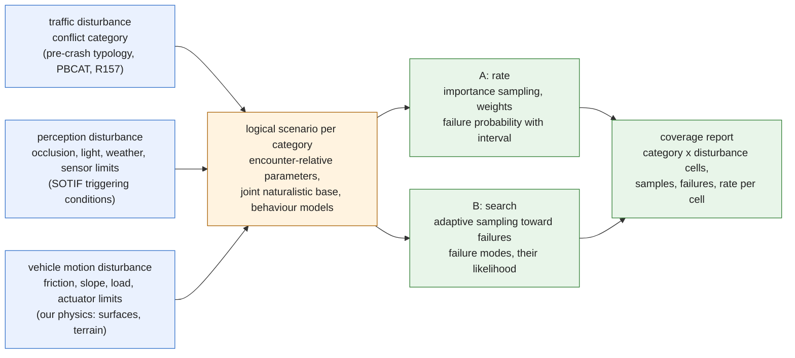

# Known risk categories, and how scenarios cover them (study)

Status: study for phase 092, 2026-11-20. It informs the sampler (K1), the sample record (S1)
and the judges; it is not a work item by itself.

Question (user): for vehicle safety studies, scenarios should give a **measurable risk** for
the autopilot under test. Two purposes, both wanted:

- **A, a realistic risk rate.** How often the autopilot fails in a category, weighted by how
  often that situation occurs.
- **B, failure-mode search.** Where and how it fails, found on purpose.

Together they give **test coverage** (which known risks were exercised, and how densely) and
**failure modes** (what goes wrong in each). Common distributions (uniform, normal) as the
sampling base do not make the outcomes realistic. So the study starts from the categories of
risk that crash research and standards already name.

## 1. Known categorisations

| Source | What it categorises | What it gives us |
|---|---|---|
| NHTSA pre-crash scenario typology ([Najm et al. 2007](https://www.nhtsa.gov/sites/nhtsa.gov/files/pre-crash_scenario_typology-final_pdf_version_5-2-07.pdf)) | 37 pre-crash scenarios covering about 5.9 M police-reported light-vehicle crashes, by the vehicles' movements before the crash | category **frequencies** from national crash data: exposure weights for purpose A. Example: lead vehicle decelerating preceded about 57 % of rear-end crashes in an earlier study by the same authors |
| PBCAT ([FHWA](https://highways.dot.gov/turner-fairbank-highway-research-center/pbcat/overview)) | pedestrian and cyclist crash types, from location and each party's manoeuvre (PBCAT 3) | the subtypes of "a walker crossing": the walker's direction, in or out of a crosswalk, the motorist's manoeuvre (straight, turning) |
| Euro NCAP AEB protocols ([car-to-car](https://cdn.euroncap.com/media/70312/euro-ncap-aeb-c2c-test-protocol-v41.pdf), [VRU](https://cdn.euroncap.com/media/26997/euro-ncap-aeb-vru-test-protocol-v20.pdf)) | fixed test grids: stationary, moving and braking lead cars (CCRs, CCRm, CCRb); nearside, farside and longitudinal pedestrians (CPNA, CPFA, ...) | comparable fixed points inside each category; a floor of coverage everyone recognises |
| UN R157 (ALKS) ([de Gelder et al.](https://arxiv.org/abs/2409.01117)) | three critical highway scenarios: cut-in, cut-out, lead vehicle deceleration; two reference driver models (CCDM, FSM) | the **reference-driver** idea: a failure counts against the autopilot when a competent careful driver would have avoided it. Caveat: the models' validity against real near-crashes is disputed ([Chalmers](https://research.chalmers.se/publication/545082/file/545082_Fulltext.pdf)) |
| JAMA safety evaluation framework (SAKURA), basis of ISO 34502 ([JAMA v4.0](https://www.jama.or.jp/english/reports/docs/Automated_Driving_Safety_Evaluation_Framework_Ver4.0.pdf), [ISO 34502](https://www.iso.org/standard/78951.html)) | three disturbance kinds: **traffic**, **perception**, **vehicle motion**; functional scenarios from them (58 from version 3.0, per a secondary source) | the **axes** of a coverage model; critical scenarios derived from risk factors; constrained random testing for unknown ones |
| ISO 21448, SOTIF ([preview](https://webstore.ansi.org/preview-pages/ISO/preview_ISO+21448-2022.pdf), [triggering-condition taxonomy](https://arxiv.org/pdf/2303.04029)) | functional insufficiencies and the **triggering conditions** that expose them (glare, rare objects, weather, sensor limits) | the perception axis in detail; one study derived 87 triggering conditions for an L3 car, and 8 of the 20 field-tested triggered risky behaviour |
| Waymo collision avoidance testing ([arXiv 2212.08148](https://arxiv.org/abs/2212.08148)) | responder-role conflicts initiated by others, from driving data, crash records and expert knowledge; a NIEON reference driver | the method: a library that converges per operational domain; collisions and serious-injury potential judged against a reference driver |
| Feng et al., dense RL ([Nature 2023](https://www.nature.com/articles/s41586-023-05732-2)) and accelerated evaluation (Zhao et al. 2016) | naturalistic driving environments with the non-critical states removed; importance sampling | purpose A at practical cost: 10^3 to 10^5 times fewer miles for the same estimate |

What they agree on:

- **Category first, then parameters.** Risk is organised as named conflict categories, and
  each has a parameter space.
- **Weights from real exposure or crash data.** The categories are not equally likely.
- **A reference behaviour to judge preventability.** A collision alone is not a failure if
  nobody could have avoided it.
- **Search for the unknown on top.** The catalogue is never complete (SOTIF, ISO 34502's
  constrained random testing).

## 2. A coverage model for our studies

A **cell** is one traffic category under one perception condition and one vehicle-motion
condition. Example: *lead vehicle decelerating* × *low sun ahead* × *wet road*. Coverage is
reported per cell:

- samples run;
- the density of samples near the critical region;
- failures found;
- the estimated rate, with its interval;
- the failure modes clustered.

The vehicle-motion axis is where scensim is strong: surfaces per scenario, terrain, measured
cars and physics. Most scenario libraries leave this axis thin.

## 3. Making each category realistic

| Element | Rule |
|---|---|
| **Parameters** | encounter-relative, so every sample is an encounter: time to conflict at the walker's entry, time headway, time to collision at brake onset. Not absolute start times or positions |
| **Base distribution** | joint, fitted from naturalistic data for the setting (highD-type highway data, inD-type intersection data, or the user's own logs), keeping the dependencies: speed and headway, walker type and speed, friction and deceleration |
| **Behaviour** | the other road user runs a behaviour model, not a fixed path: a walker with gap acceptance (it decides to go from the time to arrival); a lead car with a car-following model and a braking cause. The model's own parameters are sampled from data |
| **Feasibility** | constraints reject the impossible (deceleration at most μ·g, a walker who never enters the lane, spawning inside objects); the rejection rate is reported |
| **Category weight** | from crash or exposure data for the study's region (NHTSA's typology frequencies, or local statistics), for combining cells into an overall rate |
| **Reference driver** | a judge compares the outcome with a reference model (R157's CCDM or FSM, or a NIEON-like attentive driver): *unavoidable*, *avoidable by the reference*, *avoided by both*. Only the second kind is the autopilot's failure in the strict sense |

## 4. The two purposes, in sampling terms

**A, the rate.**

- Draw from a proposal concentrated near the critical region (where time to conflict is
  short).
- Weight each sample by base / proposal.
- Estimate the failure probability per cell, with a confidence interval.
- The sample record carries the base distribution's id, the proposal's id and the weight, so a
  rate can be recomputed and audited.

**B, the search.**

- An adaptive sampler moves toward failures and boundaries: Bayesian optimisation,
  cross-entropy, or a bandit over cells, as in 077's gap campaign.
- Each failure found is a **failure mode**. It is clustered by its parameters and by the
  autopilot's behaviour, and replayed on seats.
- Its likelihood under the base distribution is recorded, so a realistic failure ranks above a
  contrived one.

**The two feed each other.** B's failure regions sharpen A's proposal, and A's rates tell
whether a mode B found matters.

## 5. The two examples as category families

**A walker crossing** (PBCAT-style subtypes):

| Subtype | Distinguishing parameters |
|---|---|
| near side, unobstructed | side, angle, walker type and speed, time to conflict at entry |
| far side | the same, crossing the far lane first |
| dart-out from occlusion | occluder (parked car, van) and its offset; the walker visible only late |
| ego turning across the walker | the ego's turn at a junction; the walker in the crosswalk |
| walker hesitates or turns back | the behaviour model's parameters: stop mid-lane, return |
| group or child | walker type, which conditions speed and gap acceptance |

**The lead car brakes suddenly** (pre-crash typology, R157, Euro NCAP CCRb):

| Subtype | Distinguishing parameters |
|---|---|
| lead decelerating, straight | headway, speeds, deceleration, jerk, onset |
| lead decelerating in a curve | the above, plus curvature; the lead's heading against the lane |
| cut-in, then brake | the cut-in's lateral speed and gap, then braking |
| cut-out, revealing a slower car | the revealed car's speed and distance |
| braking for a cause | the cause (a walker, a stopped car) sets the timing correlations |
| on a low-friction surface | friction (a world knob), which limits both cars' braking |

Each subtype is one logical scenario: one OpenSCENARIO file with its distribution. All the
subtypes share one category id, so coverage aggregates them.

## 6. What this asks of scensim, as components and specs

- **The sample record (S1)** gains: category id, cell (the axes' values), base distribution
  id, proposal id, weight.
- **The sampler (K1)** gains plug-ins: a joint naturalistic model, importance sampling, and
  adaptive search. A scenario names one through `UserDefinedDistribution` (OpenSCENARIO 1.3),
  which SSv2 parses but does not evaluate. The sampler evaluates it and hands SSv2 concrete
  values only.
- **Behaviour models for actors** (a gap-acceptance walker, a car-follower with braking
  events) are controllers that a scenario names and that the compiler binds on each target.
  They are examples first, not maintained blocks, per D1.
- **Judges** (users' plug-ins, with examples): collision and its severity (delta-v), the
  minimum margin (time to collision, distance), and the reference-driver comparison.
- **A coverage report** over sample records: cells, samples, failures, rates and intervals,
  failure clusters. It is a component that reads records; it does not run anything.
- **A starter catalogue** of the two families above, as examples to copy, not a library to
  maintain.

## 7. Open questions

1. **Which data fits the base for a study?** Public highD- and inD-type data, or the lab's own
   logs (the NTU campus twin)? Each region's behaviour differs (walking speeds and gap
   acceptance differ by country), and private data stays out of public scensim.
2. **Which reference driver?** R157's models are disputed against real near-crashes; a
   NIEON-like model is stricter. Possibly both, reported side by side.
3. **Severity.** Delta-v is a proxy for injury. Is it enough for the studies, or is an injury
   risk curve needed?
4. **Category weights.** U.S. typology frequencies or local (Taiwanese) crash statistics for
   combining cells?
