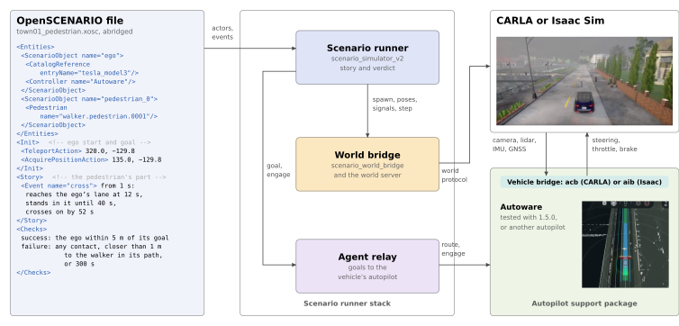
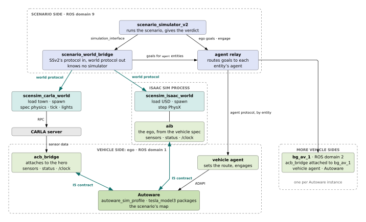

# How it works

Why scensim is shaped the way it is: the parts of a run, and the
project, stack and run a user works with. No steps here; the tutorials have them.

   
  <em>A formal scenario, a simulator, and the bridge between them and the autopilot.</em>

## The parts of a run

   
  <em>The processes of a run and the two boundaries every simulator implements (teal).</em>

- **The scenario side.** scenario_simulator_v2 (SSv2) runs an OpenSCENARIO scenario and
  judges it. It talks to a simulator over its `simulation_interface` protocol; the
  **bridge** (`scenario_world_bridge`) is that simulator, and turns SSv2's requests into
  one simulator-neutral protocol, the world protocol.
- **The world server**, one per simulator: `scensim_carla_world` for CARLA, `scensim_isaac_world`
  for Isaac Sim. It loads the map, spawns and moves the other road users, sets the traffic
  lights and steps time. The bridge knows no simulator; a new simulator is a new world
  server ([Your simulator](../how-to/your-simulator.md)).
- **The vehicle side**, one per vehicle an autopilot drives: the car's sensors, its vehicle
  interface (`/control/command/*` in, `/vehicle/status/*` out) and the clock, as Autoware's
  ROS topics. On CARLA a vehicle bridge (acb) does it; on Isaac Sim the world server itself
  (aib's PhysX car).
- **The driver** of that vehicle: Autoware, or any autopilot. It sees only the vehicle
  side, so it cannot tell a simulator from a car.
- **The agent relay** carries the scenario's commands to each driver: SSv2 speaks
  Autoware's API, the relay serves it, and forwards each call over TCP to the **agent**
  registered under the entity's name, which drives the autopilot. So SSv2 can drive several
  autopilots in one scenario, each in a ROS domain of its own
  ([ROS domains and DDS](domains-and-dds.md)).

The ego's sensors are the simulator's: SSv2's sensor requests are declined, and Autoware
has to see the pedestrian and the car ahead with its own perception.

**One car, one source.** A car is described once, in a vehicle spec. The simulators'
physics and sensors, SSv2's catalog entry and Autoware's vehicle packages are made from
it, and each names the spec's hash; the bridge refuses an ego whose parts name different
specs, or whose body is more than 2 cm off its catalog box ([Your car](../how-to/your-car.md)).

**Time** is the scenario's. SSv2 steps the world frame by frame through the bridge (CARLA
in synchronous mode, Isaac's world server stepped), as fast as the slowest part keeps up,
so a slow frame slows the clock rather than losing physics. Every process reads the
simulation clock. A world load starts a new episode whose clock starts again, and an
Autoware cannot follow time back: on CARLA a town change ends every vehicle side, and the
stack starts them again.

## Project, stack, run

| Word | Means |
|---|---|
| project | a directory holding one use case: `swb.yaml`, scenarios, suites |
| stack | the long-lived processes of a project on one seat: world server, bridge, relay, pilots |
| run | one scenario (one parameter set, one repetition) against a live stack, ending with a result |
| suite | many runs: a list, a parameter grid, repetitions |
| pilot | what drives one scenario entity: a vehicle side scensim starts, plus a driver |
| seat | one stack's share of a host: ROS domains, ports, web port, GPU |

**Each fact has one owner.** The scenario owns its map, its entities, their cars and which
of them are driven from outside SSv2 (controller `Autoware` or `agent`). The project owns
who drives each of those (`pilots:`), which assets at which versions (`assets:`, pinned by
`scensim.lock`), and the simulator. The host owns its seats, GPUs, install paths, log and
cache folders. So a scenario runs unchanged in any project with its map, a project runs
unchanged on any host after `assets fetch`, and a host change never edits a project.

**Assets by name.** A project names datasets and the part of each it takes; `assets fetch`
puts them in a read-only cache shared by every project and links them into `assets/`.
Scenarios name maps `$(env SCENSIM_MAPS)/<map>`, world files their stage `${SCENSIM_CARLA_USD}/...`;
the stack sets both. What the stack writes for a map (CARLA's signal table, Isaac's ruts,
the project's ground) goes to the project's `state/<map>/`, never into the shared map.

**A long-lived stack.** Bringing up a world server and an Autoware takes minutes; a
scenario takes one. So the stack stays up and serves run after run: a run checks that the
stack was started from this project's state (a fingerprint of `swb.yaml`, the lock and the
pilots), moves the pilots to the scenario's map when it differs, starts SSv2 on the
scenario, and records the result. A pilot that ends (an episode end, a crash) is started
again by the stack.

**A run leaves a record**, beside the logs of every process cut to the time of the run,
and a verdict: `passed`, `failed` or `error`, the last for a run the stack could not judge
([Verdicts](verdicts.md)).

**Seats.** Several stacks on one host (users, projects, a lab) must not share a ROS domain,
a port or a CARLA. A seat number gives each its own; the host's table maps the number to
domains, ports and a GPU ([Several stacks on one host](../how-to/several-stacks.md)).

For developers, the design in full:
[Projects, stacks, runs and pilots](../design/projects-and-pilots.md) and
[the architecture](../design/architecture.md).
