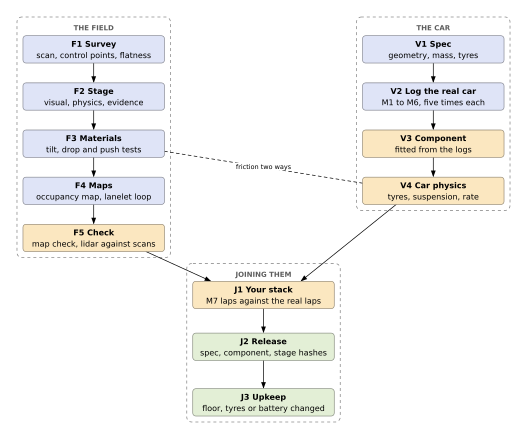

# A RoboRacer indoor twin

This page builds a simulated twin of a small car (a RoboRacer, F1TENTH class) on an indoor
field, for Isaac Sim, so that your own stack can drive it as it drives the real car. A twin
has two halves, built from measurements: the field and the car. Your stack then joins them,
and the twin is accepted when its laps match the real ones. The page assumes a testbench on
Isaac Sim ([Getting started on Isaac](../getting-started/isaac.md)) and a spec of your car
([Your car](your-car.md)).



Blue steps are yours, done with your own equipment and Isaac's editor. Amber steps are checks,
and green ones are the release and its upkeep. The dashed line is a cross-check: the floor's
friction is measured twice, once on the field and once with the car.

## The field

### Survey

Scan the field with a handheld or terrestrial lidar, or by photogrammetry. Fix the scale and
the level with control points: taped distances or a total station. Map the floor's flatness;
a small car feels a few millimetres. The survey's processing is yours; scensim begins at the
stage.

### The layered stage

The field is a USD stage in metres with Z up, holding the field only: floor, walls, cones,
furniture. The car comes from your spec, never from the stage, so a stage that holds a PhysX
vehicle is refused. Build it in layers, in Isaac's editor:

- **Visual**: the scan as Isaac's NuRec Gaussian splats or as a mesh. It has no collision.
- **Physics**: colliders authored over the visual layer, at the floor's and walls' surfaces.
  This layer is required, since splats and scan meshes collide with nothing; a stage with no
  collider is refused.
- **Evidence**: the raw scan and the measurement files. They are not composed into the stage.
  They are listed beside it, and every run records their hashes.

The root stage sublayers the visual and physics layers. The map directory then holds the stage
and a world file, `isaac/world.yaml`:

```yaml
usd: field.usda                 # relative to the map directory, or absolute
authored: true                  # the stage's own materials decide the ground
map_origin: [0.0, 0.0, 0.0]
ground_paths: ["/World/env/floor"]
evidence: [scan/field.e57, scan/tilt_tests.csv]
```

scensim never writes into your layers. The world server references your stage into a layer
of its own and makes every change there. A stage with unsaved edits in any of your layers is
refused, naming the layer.

### Materials

**The floor.** The quantity to enter is the peak friction of your tyre on the floor. Measure
it with a tilt test. Fix a tyre, or the car with its wheels locked, on a board covered with
the floor's surface, or on a hinged section of the floor itself. Raise the board slowly until
the tyre slips, and read the angle θ. The peak friction is tan θ. Repeat it five times per
floor zone, and take the mean if the spread is within your angle's resolution. A wider spread
usually means a wet or dusty patch, or a tyre that is not at room temperature: find it, and
repeat the trials.

Measure it a second way, with the car (M6 in the protocol below): drive a circle and raise the
speed slowly until the car slides. The lateral acceleration at the slide, divided by g, is the
same peak friction. The two values must agree within their resolutions before the value goes
into the stage. When they do not, the tilt test's surface or the tyre's condition differs from
the run, and the cause should be found before fitting the car to either value.

Enter the value in Isaac's editor as the floor material's **Dynamic Friction**. Create a
physics material, bind it to the floor's collider (the binding's purpose is physics), and set
the value in the Property panel's physics material section. scensim scales it against dry
asphalt (1.12) for the tyre model, so a floor entered at 1.12 grips as asphalt does. Walls,
cones and every other contact use the value as entered. Static friction is not read for the
tyres.

A floor with several surfaces gets one collider and one material per zone. A collider may
instead name a surface class (`scensim:surface`, a token such as `concrete`), which brings the
class's whole tyre curve. A named class takes precedence over the material.

**Walls and cones.** Restitution comes from a drop test: drop the object, or a sample of the
wall's surface, from a height h₀ onto the floor and measure the rebound height h₁. The
restitution is √(h₁/h₀). Friction comes from a push test: pull the object slowly across the
floor with a spring scale and read the force F at which it starts to slide. The friction is
F divided by the object's weight. A tilt test of the object gives the same value. Weigh every
object that can move, and author its mass.

A friction measured between two real objects belongs to the pair, not to either one. PhysX
combines the two materials' values, by averaging them when no combine mode is authored. So
author the measured pair value on both materials, or set a combine mode (minimum or maximum)
and author each side so that the combination gives the measured value.

**Sources.** Each measured prim carries its source in the attribute `scensim:source`: a note
(`"tilt test, 12 trials"`), or the path of the measurement's file, which runs then hash. The
map check notes a floor friction that has no source; it does not refuse it.

### Maps for your stack

Your stack's own occupancy map (`map.pgm` and `map.yaml`) is made from the scan with your own
tools, as for the real car.

SSv2 also needs a Lanelet2 map, even when every entity is placed by position. Draw the track's
centreline as a closed list of x, y points in the map frame, either as a CSV file or as a
`BasisCurves` prim in the stage, and generate one lane along it:

```bash
python -m scensim_isaac_world.loop assets/maps/field --centreline track.csv \
    --width 1.0 --direction forward --chunk 5 --speed-limit 10
```

`--direction forward` drives in the centreline's order, `reverse` against it; a route against
the lane's direction is impossible, so the direction is written in the map's header. The tool
refuses a centreline that crosses itself, and a bend tighter than half the lane's width. Its
latitudes and longitudes are synthetic, placing the field at 0, 0 by convention, and the map
says so. It also writes a flat point cloud of the lane, which SSv2's map loader requires; it
is not a localisation map.

### Check

`scensim testbench check` runs the map check on every map whose world file says
`authored: true`, in a Python with USD (Isaac's, or one with `usd-core`). It refuses a stage in
other units than metres or not Z up, a PhysX vehicle in the stage, a stage with no collider,
an unresolved layer or asset, an unknown surface class, a friction out of range, a missing
evidence file, and a map directory with no Lanelet2 map. Without a Python that has USD, the
check is skipped, and the output says so and why.

At each load, the world server records what the stage was in `stage.json`, in the map's state
directory, and every run copies it into its `result.json` under `provenance.stage`. It holds
the sha256 of every layer, asset and evidence file and one hash over them all, the measured
attributes with their sources, and any value the run replaced. Large files are hashed once and
then recognised by their size and modification time.

Finally, compare the simulated lidar with real scans taken at known poses. The planar lidar
publishes one revolution per frame, so keep the frame rate below the scanner's: a 40 Hz scanner
at 20 Hz frames gives 20 Hz scans, and at or above its rate the scans split. A tool for this
comparison is planned; until then, overlay the two scans yourself and look for walls that do
not coincide.

## The car

### Spec

Measure the car's geometry, mass, inertia, wheels, tyres and steering limits, and write them
in a spec of your own with `powertrain.model: component` ([Your car](your-car.md)).

### Log the real car

Log each manoeuvre below at least five times at the same condition, from the same battery
window (for example 7.6 to 8.2 V on a 2S pack), with the tyres at room temperature. Record the
commands, `/sensors/core`, `/sensors/imu/raw`, `/odom` and `/scan` in a rosbag, and a reference
pose from motion capture or from scan matching against a prior map. Note the battery voltage,
the floor's state and the tyres' age with every log.

| | manoeuvre | conditions | quantities |
|---|---|---|---|
| M1 | speed step from rest | 1, 2 and 4 m/s, and the highest safe speed | dead time, 10 to 90 % rise time, overshoot, steady speed |
| M2 | coast-down | from steady 2 and 4 m/s to a neutral command | speed against time; a fit `a(v) = c0 + c2 v²` |
| M3 | braking | from steady 2 and 4 m/s to speed 0 | stopping time and distance |
| M4 | steering step | 1 m/s, centre to full lock and back, both sides | steering dead time and rate |
| M5 | steady circles | tyre angles 0.1, 0.2, 0.3 rad and full lock, 1, 2 and 3 m/s | radius, yaw rate, the understeer gradient |
| M6 | grip limit | a circle, speed raised until the car slides | lateral acceleration at the slide |
| M7 | laps | your stack, five laps at race settings | lap time, the speed along the lap, the closest wall distance |

M1 to M4 fit your component. M5 and M6 fit the tyres and the floor. M7 accepts the whole twin.

### Your component

Your component models the VESC, the motor and the servo. Fit its parameters to M1 to M4, then
replay the logged commands into it and compare its output with the logged `/sensors/core`. A
tool for the fit and the replay is planned; until then, both are done by hand against the
bands below.

### Car physics

Fit the tyre and suspension values in the spec to M5 and M6: per axle, `tires.front` and
`tires.rear`, and the body's contact with walls, `body.contact` (restitution, friction and
combine mode). Isaac applies them all; a CARLA testbench applies no `body.contact` and records
it as not applied. As a starting point, 240 Hz with the TGS solver held a 1/10 car's wheels
against a wall and kept the results stable, while below 200 Hz they slipped; a suspension near
5 Hz behaved, and a softer one sat on its stops. Then run M1 to M6 in the twin and compare each
quantity with the bands. A fitting tool and a
comparison harness are planned; until then, run the manoeuvres as scenarios and compare the
values yourself.

## Acceptance

Each quantity at each condition has a band: from the smallest real value minus the measurement
resolution to the largest plus it. The resolution is the topic's period for times, and the
reference's position noise for distances (about 0.02 m with motion capture, 0.05 m with scan
matching). The twin passes a quantity when its value lies in the band. When the real spread is
smaller than the resolution, the band is the real mean plus or minus twice the resolution. A
speed trace (M1, M2) passes when its RMS difference from the real runs' mean trace is at most
1.5 times the largest RMS difference of any real run from that mean.

The twin is deterministic, so one run per condition suffices, unless your component models
noise; then five seeds are run, and the band applies to their range. A failed band is reported
for its quantity and condition and is never averaged with the others.

## Joining them

### Your stack

Run your stack against the twin at the `vesc` level, as it runs on the real car: set the
pilot's `vehicle_interface: vesc` (or `ackermann`, for a stack that publishes `/drive`). The
`vesc` level needs your workspace's `vesc_msgs` built for Isaac's Python, once per host
([The project file](../reference/project-file.md#the-vehicle-interface)). Then drive the five
laps of M7. The laps are compared with the real laps by the same bands.

### A twin release

When the twin passes, commit the testbench as a release. It names the spec (each run records
its `spec_hash`), the component (its entry point, version and file hash), the stage (its hash
in `provenance.stage`), and the session conditions in which the fit was made. Randomisation,
if you use it, stays within the real runs' spread. A record of the session conditions for
each run is planned; until then, keep them in the testbench beside the release.

### Upkeep

A twin is valid for the field and car it was measured on. When the floor changes, repeat the
tilt test and M6. When the tyres change, repeat M5 and M6. When the battery changes, repeat M1
to M3. Then refit, and commit a new release.
