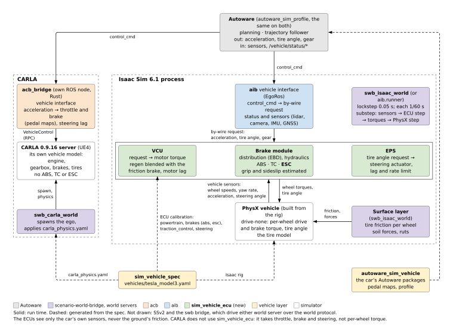

# Phase 055: The Car's Onboard Computers

Move the Isaac ego's onboard control out of its vehicle bridge into a repository of its own,
`sim_vehicle_ecu`, where a real car has it: below the drive-by-wire interface, on the car's
own sensors. The drive unit's controller, the brake module (brake distribution, ABS, traction
control, ESC) and the power steering become one simulator-free library that the Isaac host
steps every physics substep beside PhysX. aib keeps what a vehicle bridge does: Autoware's
command in, status and sensors out, and the PhysX vehicle.

**Status**: in progress, 2026-10-25.

**Source**: user direction 2026-10-25, after 054 step 3: "Aib is the bridge. I don't think
it's a proper place to do control adjustment. The Autoware focus on planning and high level
control. It's not a home to ESC too. The esc seems to live in on board computer in practice.
Find the proper place to run ESC to reflect real world fact", then "I would have a new repo
sim_vehicle_ecu", then (on the diagram) "Good to me. Update or create phase docs and start
implementation until the refactor is complete. Record a proof run video afterwards".

**Fixes**: [issue 007](../issues/007-onboard-control-in-the-bridge.md). **Depends on**:
[051](051-target-shape.md) (the repositories and the spec), [054](054-sliding-on-soft-ground.md)
steps 2 and 3 (the manoeuvre suite, the ESC). **Blocks**: 054 step 4 (T1 changes the tire and
powertrain path this phase moves).

Not in this phase: CARLA (its car takes throttle, brake and steering, not per-wheel torque, so
it keeps its own model and acb's pedal maps); enabling ESC on the shipped Model 3 (still the
user's decision, 054); a rate for the onboard computers other than the physics substep.

## Design



Source: `docs/design/vehicle-ecu.typ` (`typst compile` it to the SVG). On a real car the
layers are:

| layer | real car | here, on Isaac |
|---|---|---|
| planning, high-level control | Autoware: acceleration and tire angle | Autoware |
| vehicle interface | the drive-by-wire adapter | aib (`EgoRos`): the command becomes the by-wire request |
| onboard computers | drive unit controller (VCU), brake module (EBD, ABS, TC, ESC), power steering (EPS) | **`sim_vehicle_ecu`** |
| actuators | the motor and inverter, the brake hydraulics, the steering motor | `sim_vehicle_ecu` too: PhysX's drive-none vehicle has none, and they are simulator-free |
| the car's body, tires, ground | physics | PhysX, the surface layer |

**The interface** (`sim_vehicle_ecu`):

```python
ecu = Ecu(Calibration.from_spec(spec_doc, overrides))
act = ecu.step(Request(acceleration, velocity, tire_angle, gear),
               Sensors(wheel_speeds, yaw_rate, accel_x, accel_y), dt)
act.drive, act.brake   # per wheel, N m (FL, FR, RL, RR)
act.tire_angle         # the steering actuator's bicycle angle, rad
```

The inputs are the request and what the car's own sensors read: four wheel speeds, the yaw
rate and the two accelerations (the yaw-rate and acceleration sensor of a brake module).
Nothing else: no ground friction, no true velocity, no PhysX slip. What the controllers need
beyond that, the onboard computers estimate, as a real brake module does:

- **Reference speed**: predicted from the longitudinal acceleration, corrected toward the
  wheels: all four when free rolling, the undriven ones under drive, the fastest under
  braking; trusted less while ABS or TC is working a wheel.
- **Wheel slip**: each wheel's speed against the reference, over `max(|v|, slip floor)`, the
  floor at PhysX's own active slip denominator (4 m/s), which the ABS and TC thresholds were
  tuned against.
- **Sideslip**: the kinematic integral (`beta' = a_y / v - r`) with a washout.
- **Friction**: the acceleration the car reaches when it is at its limit (ABS or TC working,
  a sideslip, or turning less than the steering asks), recovering slowly toward the design
  value when it is not.

The ESC's target yaw rate is then capped by the estimated friction, not the ground's.

**Calibration** comes straight from the spec (`powertrain`, `brakes` with `abs` and `esc`,
`powertrain.traction_control`, `steering`, and the geometry and mass the feedforward needs):
`Calibration.from_spec` reads a loaded spec's document, so the repository needs no generator
and no generated file. aib passes the spec its rig names and checks its `spec_hash` against
the rig's; an ego config's `ecu:` mapping overrides calibration fields by name for
experiments, as `vehicle:` does the PhysX fields.

**What stays in aib**: the PhysX vehicle (geometry, inertia, tires, suspension), the
mechanical parts the ECU does not run (the Ackermann linkage, the brake's torque capacity,
the steering's mechanical stop), the road loads on the body (they are the world, not the
car's estimate of it), the sensors and the vehicle interface. `VehicleParams` holds the PhysX
vehicle only.

**Rate**: every physics substep (1/60 s), the rate the controllers had in aib. A real brake
module runs at 100 Hz or more; that needs more PhysX substeps and is not this phase.

**Repository**: `NEWSLabNTU/sim_vehicle_ecu`, pure Python 3 (standard library only, so Isaac's
Python 3.12 and the system's both import it), a submodule of aib under `deps/` and of this
repository under `src/`, pinned and checked like the others (`scripts/check_pins.py`).

## Steps

1. **Docs**: this phase, issue 007, the design note in
   [design/vehicle-side.md](../design/vehicle-side.md) and the diagram.
2. **`sim_vehicle_ecu`**: the repository; the controllers and actuators moved from aib with
   their tests (the same numbers: each controller still takes the speed and slips as
   arguments, so aib's powertrain and ESC tests port unchanged in substance); the estimator;
   `Ecu`; `Calibration.from_spec`.
3. **aib**: `VehicleParams` down to the PhysX vehicle; the rig regenerated; `Vehicle` builds
   the sensor readings and steps the `Ecu`; `EgoConfig.ecu`; `aib.steptest`; the tests;
   `deps/sim_vehicle_ecu` on every path Isaac's Python imports from.
4. **swb_isaac_world**: the aib pin; the spikes (`manoeuvres.py`'s `RIG=` becomes `ECU=`); the
   recorder writes the onboard computers' state.
5. **This repository**: the `src/sim_vehicle_ecu` submodule, the pins, CLAUDE.md's table.
6. **Measure**: the move alone, then the estimator, on the 054 manoeuvre suite; aib's
   `vehicle-check` on Isaac; `town01_mud.xosc` with Autoware on Isaac, recorded, and its video.

## Acceptance

- aib holds no powertrain, ABS, TC, ESC or steering actuator code, and `VehicleParams` no
  field of theirs.
- `sim_vehicle_ecu` imports nothing but the standard library; `Ecu.step` takes a `Request`
  and `Sensors` and nothing else.
- **The move is exact**: with a test estimator that returns PhysX's own speed, slips, sideslip
  and friction (spike only, never shipped), the manoeuvre suite gives 054's numbers.
- **The estimator is measured**: the suite again with it, ESC off and on, every change from
  054's numbers in the table below and explained; the dry sine with dwell still passes FMVSS
  126 with ESC on.
- aib's `just vehicle-check` passes on Isaac.
- `town01_mud.xosc` passes with Autoware on Isaac, and its video is recorded.

## Progress

## Open questions

- Whether the ESC's friction estimate is good enough on the split-mu pad, where the two sides
  differ by four times; a real ESC has the same problem.
- The onboard computers' own rate (100 Hz or more) against the substep.
