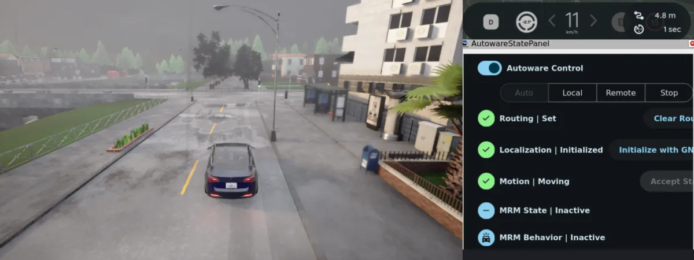

# Tutorial 1: First drive

**Goal**: Autoware drives a Tesla Model 3 70 m along a road in CARLA's Town01 to a goal,
and the verdict of the run is read back. The tutorial ends with this state:

```
~/my_ws/
  src/my_first_drive/    the testbench: package.xml, testbench.yaml, scensim.lock,
                         suites/first.yaml, scenarios/drive_to_goal.xosc
  install/               what colcon built

$ scensim runs list my_first_drive
RUN                                   VERDICT  SCENARIO            DURATION  WORKSPACE
2026-11-18T10-21-07_drive_to_goal_r0  passed   drive_to_goal.xosc  41.2s     ~/my_ws
```

<!-- TODO(exit run): replace the run id, duration and every output block of this page with
the exit run's; add a terminal screenshot of steps 4 and 5. -->

## You will learn

- creating a **testbench**, the package that holds one use case, in a colcon workspace;
- building the workspace, and editing a testbench without rebuilding it;
- fetching a testbench's assets by name;
- running the testbench, and reading the verdict and the run's records.

Terms are defined at first use; the [glossary](../reference/glossary.md) collects them.

## Before you start

- [Install](../getting-started/install.md) and
  [Getting started on CARLA](../getting-started/carla.md): scensim installed, the
  environment file written, CARLA named in the host settings (`carla.root`, so that the
  stack starts it), and Autoware 1.5.0 installed.
- Every terminal: `source ~/scensim.bash`.
- Network access to Hugging Face for step 3, about 0.1 GB of disk for the map, and an
  NVIDIA GPU with room for CARLA and Autoware ([Install](../getting-started/install.md#what-you-need)).
- About 30 minutes once the install is done.

## 1. Create a workspace and a testbench

Work with scensim lives in a colcon workspace, as any ROS work does. A **testbench** is a
package in it that names everything one use case needs: the simulator, the assets, the
scenarios, and what drives each vehicle.

```bash
mkdir -p ~/my_ws/src && cd ~/my_ws/src
scensim testbench new my_first_drive
```

**What you see**:

```
wrote src/my_first_drive (carla-first-drive); next: colcon build --symlink-install,
then scensim assets fetch my_first_drive
```

`package.xml` declares the build type that makes the package a testbench,
`scensim_testbench`. The testbench file states three things:

```yaml
# src/my_first_drive/testbench.yaml
simulator: carla
assets:
  - dataset: carla-town-autoware-maps
    take: [Town01]
pilots:
  ego: {kind: autoware, vehicle: tesla_model3}
default: first          # what `scensim run my_first_drive` runs: suites/first.yaml
```

They are the simulator; the **assets**, here Town01 from a public dataset of maps; and the
**pilot** of the entity `ego`, the vehicle under test: Autoware, on a Tesla Model 3.
`default:` names the **suite**, a list of scenarios, run when the testbench is run by name
([The testbench](../reference/testbench.md)).

**Check**: `ls my_first_drive` lists `package.xml`, `testbench.yaml`, `suites` and
`scenarios`.

## 2. Build the workspace

```bash
cd ~/my_ws
colcon build --symlink-install
source install/setup.bash
```

A testbench compiles nothing. Its build installs the files and checks them; a problem
fails the build, naming the file and the fix. `--symlink-install` links the installed
files to the sources, so that an edit takes effect without a rebuild.

**What you see**: `Summary: 1 package finished`, and one warning, because the assets have
not been fetched yet:

```
my_first_drive: no scensim.lock yet: run `scensim assets fetch my_first_drive` and
commit src/my_first_drive/scensim.lock
```

**Check**: `scensim testbench list` lists `my_first_drive` with its suite `first`.

## 3. Fetch the map

```bash
scensim assets fetch my_first_drive
```

**What you see**:

```
testbench my_first_drive: this host's assets are in .../my_first_drive/assets
carla-town-autoware-maps: <commit>: 9 file(s), 9 downloaded
src/my_first_drive/scensim.lock written
```

The map is stored in scensim's cache, shared by every testbench, and linked into the
testbench's work directory, which the first line names. `scensim.lock` records
the dataset's exact commit and each file's checksum, so that every machine fetches the
same files; it is written to the source directory and belongs in version control.

**Check**: `scensim testbench check my_first_drive` ends `testbench: ok`. A finding about
this machine rather than the package, such as a map not fetched, prints as
`problem (this host): ...`.

## 4. Run the testbench

```bash
scensim run my_first_drive
```

scensim first brings up the testbench's **stack**, the long-lived processes every run
uses, on a **seat**, one stack's share of the host's ROS domains and ports. It starts
CARLA if nothing answers on its port, the **world server** that drives CARLA, the
**bridge** that SSv2 addresses as its simulator, and the **agent relay** through which
SSv2 reaches each pilot ([How it works](../explanation/how-it-works.md)). The stack stays
up for later runs.

Then follows the **run**, one execution of a scenario against the stack. SSv2
(scenario_simulator_v2, the OpenSCENARIO interpreter that executes and judges the
scenario) places the ego at its start, gives Autoware the goal and engages it. The car
drives west and stops at the goal. With the default lidar detector Autoware is ready
within about 40 s on its first start, longer on a loaded host.

<p align="center">
  <br>
  <em>The last frame of a passing run: the ego is 4.8 m from its goal. SSv2 ends the run
  when the ego reaches the goal, so the car is still moving.</em>
</p>

**What you see**: a line for the stack, a line for the map, then, after about a minute of
driving, the verdict, the run id and the run directory, and the suite's summary:

```
stack    my_first_drive on seat 0: started (CARLA, Town01); left up, ...
map      Town01  (pilots restarted from none in ... s)
passed   2026-11-18T10-21-07_drive_to_goal_r0  .../my_first_drive/runs/2026-11-18T...
summary: .../my_first_drive/suites/first/summary.csv
```

**Check**: `echo $?` prints `0`: the run passed ([Exit
codes](../reference/commands.md#exit-codes): 1 failed, 2 error, 3 refused).

## 5. Read the result

```bash
scensim runs list my_first_drive
scensim runs show drive_to_goal
```

`runs list` has one row, `passed`, and the workspace the testbench came from. `runs show`
prints the run's header (`run`, `verdict`, `scenario`, `duration`) and its timeline: one
row per event, such as SSv2's milestones and every warning in any process's log. The run's
directory, under the log root, holds `result.json` (the verdict, its reason, the pilots
and the versions that ran), `resolved.yaml` (the scenario and settings as run) and the
logs; [Results and logs](../reference/results-and-logs.md) describes every file.

**Check**: `scensim runs list my_first_drive` shows `passed`.

## 6. Change the scenario without a rebuild

Open `src/my_first_drive/scenarios/drive_to_goal.xosc`, move the goal closer, and run the
scenario by its path:

```bash
scensim run my_first_drive/scenarios/drive_to_goal.xosc
```

**What you see**: a second `passed` line with a new run id, and no stack or map line: the
stack, Autoware included, serves one run after another, and the edit applied without a
rebuild because the build linked the file.

**Check**: the scenario path in the new run's `resolved.yaml` (in the run directory the
`passed` line names) leads, through `readlink -f`, to the file you edited,
`~/my_ws/src/my_first_drive/scenarios/drive_to_goal.xosc`.

To finish, stop the stack: `scensim stack my_first_drive --stop`. It ends every process it
started, CARLA too if it started CARLA, and frees the seat; this takes about 30 s. `scensim run my_first_drive
--stop-stack` runs and stops in one command.

## What happened

You built a workspace whose one package is a testbench and ran its scenario on a stack
that scensim started for it. The testbench holds no path of the local machine, so the
workspace runs unchanged elsewhere after `assets fetch`. Further testbenches and **support
packages**, such as your own world server ([Your world
server](../how-to/your-world-server.md)), go in the same `src/`.
[Verdicts](../explanation/verdicts.md) explains `passed`, `failed` and `error`.

## Exercises

1. **Easy.** Run the scenario three times with one command: `scensim run
   my_first_drive/scenarios/drive_to_goal.xosc --repeat 3`. Check: `scensim runs list
   my_first_drive` shows three new rows, ending `_r0`, `_r1`, `_r2`.
2. **Medium.** Add a second testbench with `scensim testbench new other_drive`, build the
   workspace, and list both. Check: `scensim testbench list` names two testbenches.
3. **Open.** Put the workspace under git, with `scensim.lock`, and clone it on another
   machine. Check: `scensim assets fetch my_first_drive` there downloads the same commit.

## If it does not work

| Symptom | Fix |
|---|---|
| `colcon build` warns `No task extension to 'build' a 'ros.scensim_testbench' package` and builds nothing | the terminal had not sourced `~/scensim.bash` before the build: source it and build again |
| `testbench my_first_drive is not in the sourced workspace: ...` | source `~/scensim.bash`, build, then source `~/my_ws/install/setup.bash`, as the message says |
| `testbench my_first_drive was built over scensim ..., but this is scensim ...` | scensim was updated after the build: `cd ~/my_ws && colcon build` |
| `swb.yaml is renamed testbench.yaml` | a project from an older scensim: `git mv swb.yaml testbench.yaml` |
| `assets fetch` prints `error: <url>: <reason>` and exits 2 | no network, or a proxy that requires `https_proxy`; a later attempt keeps the files already downloaded |
| The run ends `error`: `pilot ego never became ready (600 s)` | a slow first start: run again, or give `--ready-timeout 1200` |
| The run ends `error`, `perception is not` ready, every time; the pilot's log has `undefined symbol: _ZTVN18diagnostic_updater7UpdaterE` | an Autoware 1.5.0 rebuilt before 2026-11-17 whose libraries fail to load: install the current Autoware 1.5.0 packages |

More, CARLA's own failures among them: [Troubleshooting](../reference/troubleshooting.md).

## Next

[Tutorial 2: write a scenario](02-write-a-scenario.md): a scenario written from the map.
