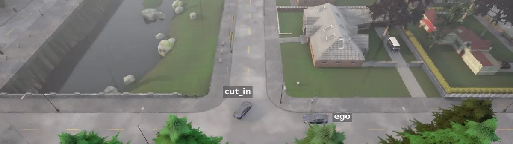

# Tutorial 4: Several pilots

**Goal**: one run on Town01 in which four vehicles are driven by four pilots of three
kinds: the ego and a second car by Autoware, each in its own ROS domain, a lead car by
CARLA's BasicAgent, and a car that cuts in by a user-written Python program.

```
$ ros2 run swb run scenarios/four_pilots.xosc
passed   2026-11-15T14-40-02_four_pilots_r0  .../multi_pilot/runs/2026-11-15T14-4...
```

## You will learn

- what a pilot consists of (a vehicle side, a driver and an agent), and the kinds swb starts:
  `autoware`, `carla_basic`, `simple`, `launch`, `command`, `none`;
- binding scenario entities to pilots in `swb.yaml`, by name or by pattern;
- checking a user-written agent without a simulator;
- the difference between a pilot that lives with the stack and one started per run.

## Before you start

- [Tutorial 3](03-other-road-users.md), so that the stack, runs and controllers are
  familiar. Stop that project's stack first (Ctrl-C), since this tutorial uses its own.
- Two Autowares and CARLA on one host: one NVIDIA GPU with room for both Autowares'
  perception beside CARLA, and 32 GB of RAM or more.
- `carla.root` in the host settings
  ([Getting started on CARLA](../getting-started/carla.md#let-the-stack-start-it-recommended)):
  the BasicAgent and the cut-in pilot need CARLA's Python `agents` package.

- About 45 minutes.

## 1. Copy the example

```bash
ros2 run swb project new ~/multi_pilot \
    --from pkg://swb_examples/projects/multi_pilot
cd ~/multi_pilot
ros2 run swb assets fetch
cat swb.yaml
```

**What you see**: the fetch as in Tutorial 1, then the pilots:

```yaml
pilots:
  ego: {kind: autoware, vehicle: tesla_model3}
  bg_av_*: {kind: autoware, vehicle: tesla_model3}   # a second Autoware, its own domain
  lead: {kind: carla_basic}                          # CARLA's BasicAgent
  cut_in:                                     # your own program: pilots/cut_in.py
    kind: command
    run: [python3, pilots/cut_in.py, --trigger-m, "40"]
    lifetime: run                             # a fresh process per run
```

`scenarios/four_pilots.xosc` has the four entities: `ego` with the controller `Autoware`,
the other three with `agent`, so all four are driven from outside SSv2. Each key of
`pilots:` is an entity name or a pattern (`bg_av_*` matches `bg_av_1`).

**Check**: `ros2 run swb project check` prints `project: ok`. It would refuse an `agent`
entity with no pilot, or a pilot kind the simulator cannot run.

## 2. Check your own pilot without a simulator

An **agent** (the process, not the controller name) is the program that registers an
entity with the agent relay and drives it; an entity whose controller is `agent` is driven
by one. `pilots/cut_in.py` is an agent written with swb's agent SDK (the `swb_agent`
Python package, [reference](../reference/agent-sdk.md)), on its `carla_basic` adapter: it
withholds the goal that the scenario gives it until the ego is within its trigger
distance, then proceeds. swb starts it as

```
python3 <project>/pilots/cut_in.py --trigger-m 40 \
    --relay <url> --entity cut_in --seed <n> --run-dir <dir>
```

The SDK's conformance check runs it over a stand-in world, with no CARLA:

```bash
echo '{"world": "fake"}' > /tmp/fake.json
ros2 run swb_agent swb-agent check pilots/cut_in.py:CutIn --config /tmp/fake.json
```

**What you see**: one line per rule of the protocol between agent and relay, each `PASS`,
ending

```
  PASS  registers again after a dropped connection
PASS: 16/16 rules
```

**Check**: `echo $?` prints `0`.

## 3. Bring up the stack

With `carla.root` set (Before you start):

```bash
play_launch launch --web-addr 127.0.0.1:8080 \
    swb_launch swb.launch.xml \
    map:=Town01
```

`map:=Town01` starts the pilots at once rather than at the first run, so that their
start can be observed.

**What you see**: `swb stack: pilot lead ready on Town01` almost at once,
`pilot ego ready` and `pilot bg_av_1 ready` once each Autoware can drive, then
`swb stack ...: ready`.

**Check**: which domain each pilot got, from the stack's record:

```bash
grep -E '"(entity|domain)"' \
    ~/.local/state/swb/logs/multi_pilot/seat-*-current/stack.json
```

Each entity has its own domain.

## 4. Run the scenario

In a second terminal, in the project:

```bash
ros2 run swb run scenarios/four_pilots.xosc
```

`ego` comes down the north arm of a T junction, turns right and drives west; `lead`
drives west ahead of it; `bg_av_1` drives east in the oncoming lane; `cut_in` waits at the
south arm's stop line and turns into the ego's road immediately ahead of it.

**What you see**: `passed   <run id>  <run directory>` when the ego yields to the car
cutting in and both Autowares reach their goals; `failed` when the ego touches any of the
others.

<p align="center">
  <br>
  <em>The cut-in, seen from a fixed camera above the junction: <code>cut_in</code>, driven by
  the Python pilot, turns into the road ahead of the ego, which approaches from the right and
  must yield. The lead car is already further west, beyond the frame.</em>
</p>

**Check**:

```bash
cat runs/*four_pilots*/logs/pilot-cut_in/cut_in.json
```

shows the trigger distance the cut-in chose for this run.

## 5. A fresh pilot per run, with a seed

```bash
ros2 run swb run suites/cut_in_seeds.yaml
```

The suite runs the scenario five times, repetition k with seed 1000 + k. `cut_in.py`
draws its trigger distance from the seed (40 m, plus or minus up to 5 m), so each
repetition cuts in at a different gap, and the same seed reproduces a run exactly.

**What you see**: five run lines, `..._r0` to `..._r4`, then `summary: .../summary.csv`.

**Check**: the five `cut_in.json` files hold five different distances.

## What happened

A **pilot** is what drives one entity: a **vehicle side** swb starts (on CARLA, the
vehicle bridge with the car's sensors), a **driver**, and the agent that registers the
entity with the relay. The kinds are `autoware`, `carla_basic`, `simple`, `launch`,
`command` and `none` ([project file reference](../reference/project-file.md#pilots)).

Every pilot gets its own ROS domain, because every Autoware uses the same topic names; the
scenario reaches each through the relay. A `lifetime: stack` pilot serves run after run; a
`lifetime: run` pilot starts with each run and can take per-run values (`{seed}`,
`{run_dir}`, `{param:<name>}`). [Your autopilot as a pilot](../how-to/your-autopilot.md)
shows `launch` and `command` for a driver of one's own; the
[project file reference](../reference/project-file.md#pilots) lists every key.

## Exercises

1. **Easy.** Drive `lead` with Autoware instead: rename it `bg_av_2` in the scenario (all
   its references), and restart the stack. Check: the stack console prints
   `pilot bg_av_2 ready`, and `stack.json` lists a third Autoware domain.
2. **Medium.** Make the cut-in later: `--trigger-m` 30 in `swb.yaml`, then restart the
   stack (a run refuses a stack started from another `swb.yaml`). Check: `cut_in.json`
   shows a distance between 25 and 35 m.
3. **Open.** Write a new pilot: `ros2 run swb_agent swb-agent new my-pilot` makes a
   skeleton that passes `swb-agent check`; assign it to an entity as a `command` pilot.
   Check: `swb-agent check` passes, and a run with the new pilot ends `passed` or
   `failed`, not `error`.

## If it does not work

| Symptom | Fix |
|---|---|
| `pilot lead` restarts again and again; its log says `No module named 'agents'` | `carla.root` is missing from `~/.config/swb/host.yaml` (step 3); restart the stack |
| One Autoware never becomes ready | two Autowares need GPU memory and RAM: close other GPU work; read `runs why` and the pilot's log under the stack's `proc/pilot-<entity>/` |
| `refused: entity bg_av_1 ... has no pilot in the stack` | the stack started before the pilot was added: restart it |

## Next

[Tutorial 5: suites](05-suites.md): parameters, repetitions and the results table.
