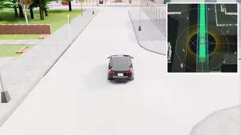
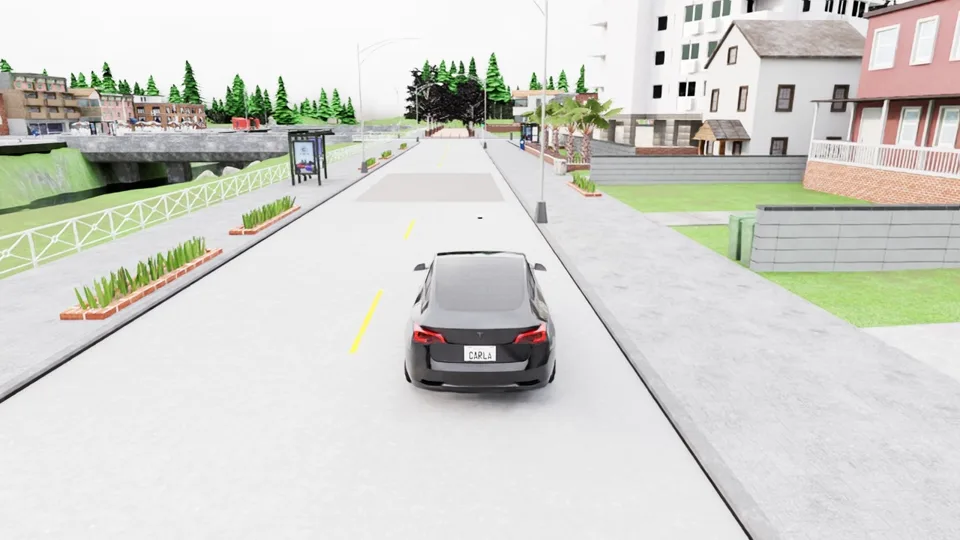

# Tutorial 6: The same project on Isaac Sim

**Goal**: Autoware drives the Tutorial 2 scenarios on Isaac Sim, in CARLA's Town01 loaded
from CARLA's own assets in USD (Universal Scene Description, Isaac Sim's scene format),
with a scenario's cars and props rendered in CARLA's models.

<p align="center">
  
</p>

## You will learn

- that a scenario names its map, not its simulator, so that the same `.xosc` runs on
  CARLA and on Isaac Sim;
- what CARLA's asset set in USD contains, and how a project takes only the part it needs;
- how a map's Isaac world file (`isaac/world.yaml`) names the USD scene to load, and how
  to make one with `make_world`;
- rendering scenario entities in CARLA's models with `model3d`.

## Before you start

- [Getting started on Isaac Sim](../getting-started/isaac.md): Isaac Sim installed (6.1
  is the tested version) and `isaac.root` in `~/.config/scensim/host.yaml`.
- [Tutorial 1](01-first-drive.md) and [Tutorial 2](02-write-a-scenario.md), on CARLA:
  everything except the simulator works the same way here.
- An NVIDIA RTX GPU with 24 GB and 64 GB of RAM
  ([Getting started on Isaac Sim](../getting-started/isaac.md#what-you-need)); no CARLA
  stack beside it.
- About 19 GB in scensim's cache on a fast disk, and several hours for the first download and
  the first load of a town (the download took 2 h 28 min on one host on 2026-11-16).

## 1. Copy the Isaac example

```bash
ros2 run scensim project new ~/isaac_first_drive \
    --from pkg://scensim_examples/projects/isaac_first_drive
cd ~/isaac_first_drive
cat swb.yaml
```

**What you see**: the project file of Tutorial 1 with `simulator: isaac` and a second
dataset:

```yaml
simulator: isaac
assets:
  - dataset: carla-town-autoware-maps
    take: [Town01]               # the Autoware map and Town01's Isaac world file
  - dataset: carla-0.9.16-isaac-usd
    take: [Town01, vehicles]     # the town and the cars in USD: 19 GB of the 25.5
pilots:
  ego: {kind: autoware, vehicle: tesla_model3}
```

`carla-0.9.16-isaac-usd` is CARLA 0.9.16's content exported to USD (six towns and the
assets). `take:` fetches only Town01 and `vehicles/` (CARLA's vehicles, props and
walkers).

**Check**: the scenarios are Tutorial 2's, unchanged:

```bash
grep LogicFile scenarios/*.xosc
```

Both name `$(env SCENSIM_MAPS)/Town01`.

## 2. Fetch

```bash
ros2 run scensim assets fetch
```

**What you see**: one line per dataset with its commit and file count, the links, and the
lock. Running the command again resumes an interrupted download, since files already in
the cache are kept.

```
linked assets/carla-usd -> .../datasets/jerry73204/carla-0.9.16-isaac-usd/<commit>
linked assets/maps/Town01 -> .../jerry73204/carla-town-autoware-maps/<commit>/Town01
```

The map's Isaac world file names its **stage**, the USD scene to load, through a variable
rather than a fixed path:

```bash
grep '^usd:' assets/maps/Town01/isaac/world.yaml
```

```
usd: ${SCENSIM_CARLA_USD}/Town01/Town01_physics.usda
```

The stack sets `SCENSIM_CARLA_USD` to the project's `assets/carla-usd`, so the world file
works in any project, on any host.

**Check**: `ros2 run scensim assets check` prints `assets: ok`, and `ros2 run scensim project
check` prints `project: ok`.

## 3. Bring up the stack

```bash
ros2 launch scensim_launch scensim.launch.xml
```

On Isaac the world server is part of the stack and loads its world at start: the first
map that the project's scenarios name, Town01, which it keeps for the stack's whole life.
Autoware starts after it.

**What you see**: the stack's lines as in Tutorial 1, then, after the world has loaded
(minutes; up to a quarter of an hour the first time), `scensim stack: pilot ego ready on
Town01` and `scensim stack ...: ready`.

**Check**, from a second terminal; the probe changes nothing:

```bash
ros2 run scensim_world_check scensim_world_check hello tcp://127.0.0.1:5591 --wait 1800
```

prints the simulator (`isaac`), what it offers (signals, contacts, road conditions, ...)
and that it is ready. `5591` is seat 0's world server port; on another seat the port is
the one `ros2 run scensim seat show` names.

## 4. Run the same scenarios

```bash
ros2 run scensim run scenarios/drive_to_goal.xosc
ros2 run scensim run scenarios/follow_to_goal.xosc
```

The ego drives west as on CARLA, in the second scenario behind a slower car.

<p align="center">
  <br>
  <em>The same Tesla Model 3 on CARLA's Town01, here rendered by Isaac Sim: the town's USD
  export, the car from the vehicle specification, Autoware driving.</em>
</p>

**What you see**: two `passed` lines.

**Check**: `grep '"simulator"' runs/*follow_to_goal*/result.json` shows `isaac`: the
same file, the other simulator.

## 5. CARLA's models in a scenario

A scenario names a CARLA model in an entity's `model3d` attribute, by its CARLA blueprint
id. On Isaac the world server dresses the entity in that model from the asset set; on
CARLA the same id spawns the same blueprint. In a copy of `follow_to_goal.xosc`,
`scenarios/follow_the_van.xosc`, give the lead car a model:

```xml
<Vehicle name="lead" vehicleCategory="car" model3d="vehicle.mercedes.sprinter">
```

Then set its `BoundingBox` to the model's size, `Dimensions` and `Center`, from the
vehicle's row of the list below, because on Isaac the body for physics, contacts and the
lidar remains the declared box; the model is only its appearance. The list gives the ids
the set holds, with each vehicle's size:

```bash
less assets/carla-usd/vehicles/vehicles.md
```

| Entity | `model3d` | Without it |
|---|---|---|
| `Vehicle` | `vehicle.<make>.<model>` | the four-wheeled car closest to its bounding box; a `bicycle` or `motorbike` gets the two-wheeler closest in length |
| `Pedestrian` | `walker.pedestrian.0001` to `0052` | a walker picked from the entity's name |
| `MiscObject` | `static.prop.<name>`, or a `vehicle.*` id | `static.prop.streetbarrier` |

An id that the set does not hold yields a plain box and a warning in the world server's
log (`no CARLA body for ...`). The ego is the exception: its body is always its own
car's.

```bash
ros2 run scensim run scenarios/follow_the_van.xosc
```

**What you see**: in Isaac Sim's window, when the stack renders one
([Getting started on Isaac Sim](../getting-started/isaac.md)), a Sprinter van leads; the
run passes.

**Check**: `ros2 run scensim runs why follow_the_van` shows no `no CARLA body` warning.

## What happened

A scenario names its map, never its simulator, so the project differed from Tutorial 1's
only by one line (`simulator: isaac`) and one dataset. The map directory is the same
Autoware map as on CARLA plus `isaac/world.yaml`, which names the world's USD stage. On
Isaac the ego is a PhysX car inside the world server, built from the same vehicle spec as
CARLA's, so there is no separate vehicle bridge, and the world server carries one ego.
[Isaac assets](../design/isaac-assets.md) describes how the asset set is made.

Worlds need not be CARLA towns:
[Drive a course on Isaac Sim](../how-to/drive-a-course-on-isaac.md) adds the Mount Haruna mountain road, built from open map and elevation data, to this
project.

## Exercises

1. **Easy.** Add a pedestrian in a CARLA model to `follow_the_van.xosc`, standing on the
   pavement (`walker.pedestrian.0012`). Check: the run passes, and the world server's log
   has no `no CARLA body` line for it.
2. **Medium.** Drive Town02: take `Town02` from both datasets, copy
   `drive_to_goal.xosc` to `scenarios/town02_drive.xosc` with the `LogicFile` on Town02 and
   poses from Town02 (on CARLA, `carla_poses`), and restart the stack with `map:=Town02`.
   Check: the run on Town02 passes.
3. **Open.** An Isaac world for a new map: copy `assets/maps/Town01` (with
   `cp -rL`) to `maps/my_town01`, add it to `swb.yaml` as
   `{path: maps/my_town01, as: my_town01}`, remove its `isaac/`, then make its world file
   from the asset set, in Isaac's Python:

   ```bash
   SCENSIM_CARLA_USD=$PWD/assets/carla-usd \
       ros2 run scensim_isaac_world make_world maps/my_town01 --town Town01
   ```

   Check: `grep '^usd:' maps/my_town01/isaac/world.yaml` prints
   `usd: ${SCENSIM_CARLA_USD}/Town01/Town01_physics.usda`, and a stack with `map:=my_town01`
   becomes ready.

## If it does not work

| Symptom | Fix |
|---|---|
| The first `assets check` takes long | it hashes the whole USD set, from a few minutes to a quarter of an hour; later checks hash only files that changed |
| `assets fetch` stops with `HTTP Error 429`, then waits and retries | Hugging Face limits anonymous downloads; `hf auth login` with a free account's token raises the limit |
| The world server never says ready | the first load compiles materials: wait, and watch its log (the stack's `proc/simulator/` directory, or play_launch's web interface); `hello --wait` shows whether it answers |
| The world server dies or hangs out of memory | it needs the GPU and about 17.5 GB of RAM to itself: close other GPU work; on two GPUs pick one with the host setting `gpu:` |
| `refused: the scenario is on map ..., the stack's Isaac world on ...` | the Isaac stack serves one world: restart it with the `map:=` the message names |

More: [Troubleshooting, Isaac Sim](../reference/troubleshooting.md#isaac-sim).

## Next

[Tutorial 7: road physics](07-road-physics.md): mud, gravel and a wet road under the
wheels.
