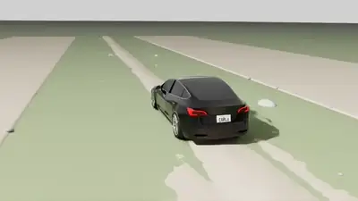

# Tutorial 7: Road physics

**Goal**: Autoware drives a Model 3 on Isaac Sim over a wet stretch, 12.8 m of wet mud and
a gravel patch on Town01, the ground given by the project, and you watch each wheel's
surface, slip and sinkage as it crosses.

<p align="center">
  
</p>

## You will learn

- what the Isaac world server models under a wheel: surface classes, soil with sinkage and
  ruts, a rough road;
- to give a map its ground from the project (`ground:` in `swb.yaml`), without editing
  the shared map;
- to check a surface map without Isaac;
- to change the road's state from a scenario with `RoadCondition`;
- to watch `/swb/wheels`, and record it with a run.

## Before you start

- [Tutorial 6](06-carla-assets-on-isaac.md): Isaac Sim, an Isaac stack that became ready
  on Town01. Stop that stack (Ctrl-C): this tutorial has its own project.
- The same hardware as Tutorial 6. The soil zone's ruts cost memory: about 100 MB per km
  of tracks in it, for as long as the world server runs.
- About 45 minutes.

## 1. Copy the example

```bash
ros2 run swb project new ~/road_physics \
    --from pkg://swb_examples/projects/road_physics
cd ~/road_physics
ros2 run swb assets fetch
cat swb.yaml ground/town01.yaml
```

**What you see**: the Isaac project of Tutorial 6 with a third dataset (2.6 MB, of which
the project takes 1 kB) and a key of its own:

```yaml
ground:                              # per map: this project's surface files
  Town01:
    surfaces: ground/town01.yaml
```

and the surface map: label defaults (roads asphalt, pavements concrete, verges grass) and
three zones along the scenarios' route, `wet_stretch`, `mud_road` (wet mud with soil on
its own ground, so it ruts) and `gravel_patch`.

The ground is a project file, not part of the map: the fetched map is shared by every
project and read-only, and another project on Town01 drives on its own ground.

**Check**, without Isaac:

```bash
ros2 run swb_isaac_world surfaces check ground/town01.yaml
```

```
warning: zone mud_road: soil on unvalidated mud_wet parameters: drawbar pull fitted ...
ground/town01.yaml: 3 zone(s), 1 with soil; 12 classes
```

The warning is expected: `mud_wet`'s sinkage is outside its tolerance, so the map opts in
by name (`allow_unvalidated: [mud_wet]`).

## 2. Hand the ground to the world server

The world server reads a map's surface map from the project's `state/<map>/` first. The
stack does not copy `ground:` there yet (2026-11-15), so do it once:

```bash
mkdir -p state/Town01
cp ground/town01.yaml state/Town01/surfaces.yaml
```

**Check**: `ls state/Town01/` lists `surfaces.yaml`.

## 3. Bring up the stack

```bash
play_launch launch --web-addr 127.0.0.1:8080 \
    swb_launch swb.launch.xml
```

**What you see**: as in Tutorial 6, ending `swb stack ...: ready`.

**Check**: in the stack's web UI, the world server's log (the simulator group) warns about
`mud_wet` and has the line `soil zone mud_road (mud_wet): grid at ...`: it read the
project's surface map.

## 4. Drive through the mud, and watch the wheels

In a second terminal, join the ego's domain and watch the wheels:

```bash
cd ~/road_physics
eval "$(ros2 run swb seat env 0)"
ros2 topic echo /swb/wheels --field status
```

and in a third, in the project, run the drive:

```bash
ros2 run swb run scenarios/mud_and_gravel.xosc
```

**What you see**: in the second terminal, four statuses per sample, one per wheel
(`ego/front_left` ...), each with its `class` and `zone`, `friction`, `slip_ratio`,
`slip_angle`, `sinkage` and `normal_load`. On the wet stretch the class stays `asphalt` at
a lower friction; in the mud it turns `mud_wet`, the slip grows and the sinkage is a few
centimetres; then `gravel`. The rear-drive car slows in the mud and crosses it; the run
ends `passed`.

**Check**:

```bash
ls state/Town01/ruts/runs/
```

lists the ruts this run left in the mud, saved when the scenario ended.

## 5. The road after rain

`scenarios/after_rain.xosc` is the same drive with the road's state set by the scenario:

```xml
<RoadCondition frictionScaleFactor="1.0" wetness="moist">
  <Properties>
    <Property name="swb.zone.gravel_patch.class" value="dirt" />
  </Properties>
</RoadCondition>
```

The whole road moist, the gravel patch turned to dirt; the mud as it was. A scenario sets
the state; it cannot choose the surface map.

```bash
ros2 run swb run scenarios/after_rain.xosc --capture full
```

`--capture full` records the run's key topics, `/swb/wheels` among them, as a rosbag, and
keeps it whatever the verdict.

**What you see**: `passed   <run id>  <run directory>`; the world server's log has
`road condition: friction scale 1, ...` at the start.

**Check**:

```bash
ros2 bag info runs/*after_rain*/record/ego
```

lists `/swb/wheels` among the recorded topics.

## What happened

The Isaac world server gives every piece of ground a surface class from its semantic label
or a zone, and computes each wheel's friction and tire curve from it every physics step.
In a soil zone it runs a soil model (sinkage, traction limit, motion resistance, ruts that
later wheels ride in); on its own ground (`ground_z`) the ruts are in the collision and
the lidar. The map's files are the project's, in `state/<map>/`, beside what the server
writes there (ruts, CARLA's signal table on CARLA), so the shared map is never edited.
Every class, zone key, road-detail key and `RoadCondition` property:
[Road physics on Isaac Sim](../reference/road-physics.md).

## Exercises

1. **Easy.** Make the mud softer: set `mud_road`'s class to `mud_soft` in your
   `state/Town01/surfaces.yaml`. The map counts from the next scenario. Check:
   `mud_and_gravel.xosc` now ends `failed` on its 180 s timeout, the car stalled in the
   mud, and `/swb/wheels` shows the rear wheels' slip near 1.
2. **Medium.** Lay the rough gravel road the stages dataset carries over Town01's
   straight: copy
   `assets/isaac-road-physics-stages/procedural/spikes/road_town/road_detail.yaml` to
   `state/Town01/road_detail.yaml` and restart the stack. Check:
   `ros2 run swb_isaac_world road_detail check state/Town01/road_detail.yaml` prints
   `1 corridor(s)` and the corridor's 250 m, and the stack starts again without a
   problem. (Autoware on the rough road is not validated.)
3. **Open.** Start from old ruts: copy a file of `state/Town01/ruts/runs/` to
   `state/Town01/ruts/worn.npz`, and in a copy of `mud_and_gravel.xosc` add
   `<Property name="swb.ruts" value="worn"/>` to a `RoadCondition` in the Init. Check: the
   world server logs `ruts: set worn from ...`, and the wheels' `sinkage` in the old ruts
   differs from a fresh run's.

## If it does not work

| Symptom | Fix |
|---|---|
| Every wheel's class is `asphalt` | the world server found no surface map: step 2, then restart the stack |
| The stack is refused, naming `surfaces.yaml` | the file failed its check: run `surfaces check` on it, which lists every problem |
| `/swb/wheels` shows nothing | the terminal is not on the ego's domain (`eval "$(ros2 run swb seat env 0)"`), or the stack is not up |
| `mud_and_gravel.xosc` fails, the car stopped in the mud | a stop inside fresh wet mud barely starts again, and Autoware's longitudinal controller does not push harder at low speed; the shipped scenarios do not stop there |

## Next

- [Road physics on Isaac Sim](../reference/road-physics.md): every key.
- [Your car](../how-to/your-car.md), to drive the same ground with a car of your own.
