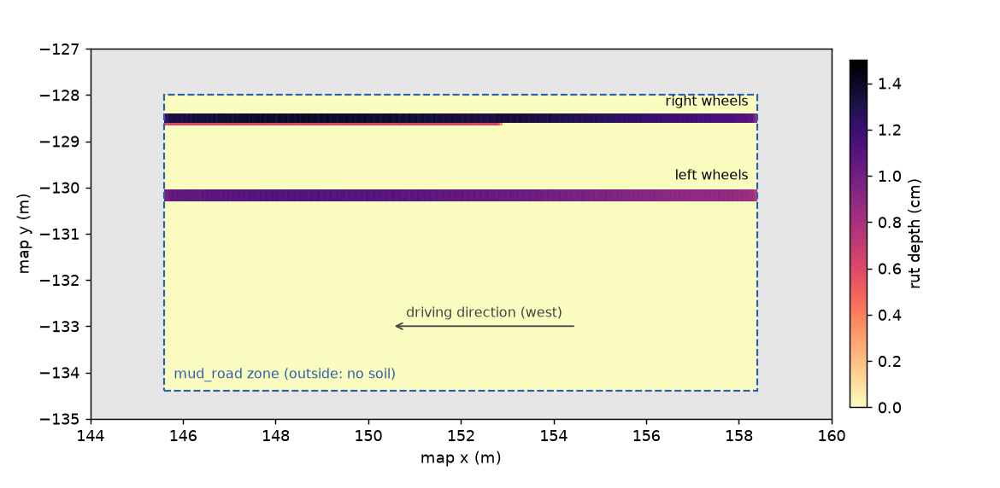

# Tutorial 7: Road physics

**Goal**: Autoware drives a Model 3 on Isaac Sim across a wet stretch, 12.8 m of wet mud
and a gravel patch on Town01, on ground that the testbench defines, while each wheel's
surface, slip and sinkage are observed as it crosses.

<p align="center">
  
</p>

## You will learn

- giving a map its ground from the testbench (`ground:` in `testbench.yaml`) and checking it
  without Isaac;
- changing the road's state from a scenario with `RoadCondition`;
- observing `/scensim/wheels`, and recording it with a run.

## Before you start

- [Tutorial 6](06-carla-assets-on-isaac.md): Isaac Sim and an Isaac stack that became
  ready on Town01. Stop that stack (`scensim stack isaac_first_drive --stop`), since this
  tutorial uses a testbench of its own.
- The same hardware as Tutorial 6.
- About 45 minutes.

## 1. Copy the example

```bash
cd ~/my_ws/src
scensim testbench new road_physics --from pkg://scensim_examples/projects/road_physics
cd ~/my_ws && colcon build --symlink-install && source install/setup.bash
scensim assets fetch road_physics
cd src/road_physics
cat testbench.yaml ground/town01.yaml
```

**What you see**: the Isaac testbench of Tutorial 6 with a third dataset
(`isaac-road-physics-stages`, small) and a key of its own:

```yaml
ground:                              # per map: this testbench's surface files
  Town01:
    surfaces: ground/town01.yaml
```

followed by the **surface map**, the file that assigns a surface class to the ground. It
gives defaults per semantic label, the class the town's meshes carry (roads asphalt,
pavements concrete, verges grass), and
three **zones**, regions that override those defaults along the scenarios' route:
`wet_stretch`, `mud_road` (wet mud with soil on its own ground, so that it ruts) and
`gravel_patch`.

The ground is a file of the testbench rather than of the map, because the fetched map is
read-only and shared by every testbench; another testbench on Town01 drives on its own
ground. At start the stack links each file that `ground:` names into `state/<map>/` of
the testbench's work directory, `<logs>/.testbenches/road_physics/` (`surfaces` as `surfaces.yaml`, `road_detail` as `road_detail.yaml`),
where the world server reads it, so `ground/town01.yaml` remains the only file to edit.

**Check**, without Isaac:

```bash
ros2 run scensim_isaac_world surfaces check ground/town01.yaml
```

```
warning: zone mud_road: soil on unvalidated mud_wet parameters: drawbar pull fitted ...
ground/town01.yaml: 3 zone(s), 1 with soil; 12 classes
```

The warning is expected: the sinkage of `mud_wet` lies outside its validation tolerance,
and the surface map accepts it by name (`allow_unvalidated: [mud_wet]`).

## 2. Bring up the stack

```bash
scensim stack road_physics
```

**What you see**: as in Tutorial 6.

<!-- TODO(exit run): confirm state/ in the work directory, and its link to ground/. -->

**Check**:

```bash
logs=~/.local/state/scensim/logs     # the log root; the host settings' logs: if set
w="$logs"/.testbenches/road_physics
ls -l "$w"/state/Town01/
```

shows `surfaces.yaml -> .../ground/town01.yaml`. The world
server's log (the stack's `proc/simulator/` directory) warns about `mud_wet` and has
the lines `soil zone mud_road: cut (...) out of 8 mesh(es)` and
`soil zone mud_road: 32 tiles of 1.6 m at z 0.00`, which show that it read the testbench's
surface map.

## 3. Drive through the mud, and watch the wheels

In a second terminal, join the ego's ROS domain and subscribe to the wheel states
(`seat env 0` prints the settings of the seat's first pilot domain, the ego's; 0 is that
domain's index, not a seat number):

```bash
eval "$(scensim seat env 0)"
ros2 topic echo /scensim/wheels --field status
```

<!-- TODO(exit run): how seat env finds the testbench's seat outside a project directory. -->

In a third terminal, start the drive:

```bash
scensim run road_physics/scenarios/mud_and_gravel.xosc
```

**What you see**: in the second terminal, four statuses per sample, one per wheel
(`ego/front_left` ...), each with its `class` and `zone`, `friction`, `slip_ratio`,
`slip_angle`, `sinkage` and `normal_load`. On the wet stretch the class remains `asphalt`
at a lower friction; in the mud it becomes `mud_wet`, the slip increases and the sinkage
reaches a few centimetres; then it becomes `gravel`. The rear-driven car slows in the mud
but crosses it, and the run ends `passed`.

**Check**: the ruts the run left in the mud are saved when the next run begins: each run's
initialization loads the world's state again, also on the same world. After the drive of
step 4,

```bash
ls "$w"/state/Town01/ruts/runs/
```

lists them.

<p align="center">
  <br>
  <em>One saved set of ruts, seen from above: the two wheel tracks of one drive west
  across the <code>mud_road</code> zone, 1.6 m apart (the car's track width), up to
  1.4 cm of lasting depth. The ruts are too shallow to see in the rendered image; the
  saved set records them.</em>
</p>

## 4. The road after rain

`scenarios/after_rain.xosc` is the same drive with the road's state set by the scenario:

```xml
<RoadCondition frictionScaleFactor="1.0" wetness="moist">
  <Properties>
    <Property name="scensim.zone.gravel_patch.class" value="dirt" />
  </Properties>
</RoadCondition>
```

The whole road becomes moist and the gravel patch becomes dirt, while the mud is
unchanged. A scenario sets the state of the road; it cannot choose the surface map.

```bash
scensim run road_physics/scenarios/after_rain.xosc --capture full
```

`--capture full` records the run's key topics, `/scensim/wheels` among them, as a rosbag, and
keeps the recording whatever the verdict.

**What you see**: `passed   <run id>  <run directory>`; the world server's log has
`road condition: friction scale 1, ...` at the start.

**Check**:

```bash
ros2 bag info "$logs"/road_physics/runs/*after_rain*/record/ego
```

lists `/scensim/wheels` among the recorded topics.

## What happened

The Isaac world server assigns every piece of ground a surface class, from its semantic
label or from a zone, and derives each wheel's friction and tire curve from that class at
every physics step. In a soil zone it also runs a soil model (sinkage, traction limit,
motion resistance, and ruts in which later wheels run); on a zone with its own flat ground
(`ground_z`, [reference](../reference/road-physics.md)) the ruts also enter the collision
geometry and the lidar. [Road physics on Isaac Sim](../reference/road-physics.md) lists every class, zone
key, road-detail key and `RoadCondition` property.

## Exercises

1. **Easy.** Make the mud softer: set `mud_road`'s class to `mud_soft` in
   `ground/town01.yaml`; the change takes effect from the next scenario. Check:
   `mud_and_gravel.xosc` ends `failed` on its 180 s timeout with the car stalled in the
   mud, and `/scensim/wheels` shows the rear wheels' slip near 1.
2. **Medium.** Lay the rough gravel road the stages dataset carries over Town01's
   straight: uncomment `road_detail:` under `ground: Town01:` in `testbench.yaml` and
   restart the stack (`--stop`, then `scensim stack road_physics`). Check:
   `ros2 run scensim_isaac_world road_detail check "$w"/state/Town01/road_detail.yaml` prints
   `1 corridor(s)` and the corridor's 250 m, and the stack starts again without a
   problem. (Autoware has not been validated on the rough road.)
3. **Open.** Start from old ruts: copy a file of `"$w"/state/Town01/ruts/runs/` to
   `"$w"/state/Town01/ruts/worn.npz`, and in a copy of `mud_and_gravel.xosc` add
   `<Property name="scensim.ruts" value="worn"/>` to a `RoadCondition` in the Init. Check: the
   world server logs `ruts: set worn from ...`, and the wheels' `sinkage` in the old ruts
   differs from a fresh run's.

## If it does not work

| Symptom | Fix |
|---|---|
| Every wheel's class is `asphalt` | the world server found no surface map: check `ground:` in `testbench.yaml` (`scensim testbench check road_physics`), then restart the stack |
| The stack is refused, naming `surfaces.yaml` | the file failed its check: run `surfaces check` on it, which lists every problem |
| `/scensim/wheels` shows nothing | the terminal is not on the ego's domain (`eval "$(scensim seat env 0)"`), or the stack is not up |
| `mud_and_gravel.xosc` fails, the car stopped in the mud | the car stalled in the mud: a car that stops in fresh wet mud rarely regains traction, and Autoware does not add torque at low speed; the shipped scenarios do not stop there |

## Next

- [Road physics on Isaac Sim](../reference/road-physics.md): every key.
- [Your car](../how-to/your-car.md), to drive the same ground with a car of your own.
